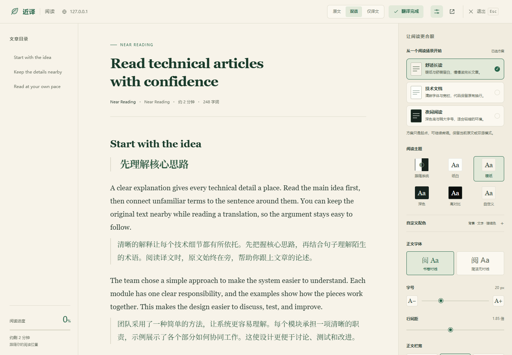
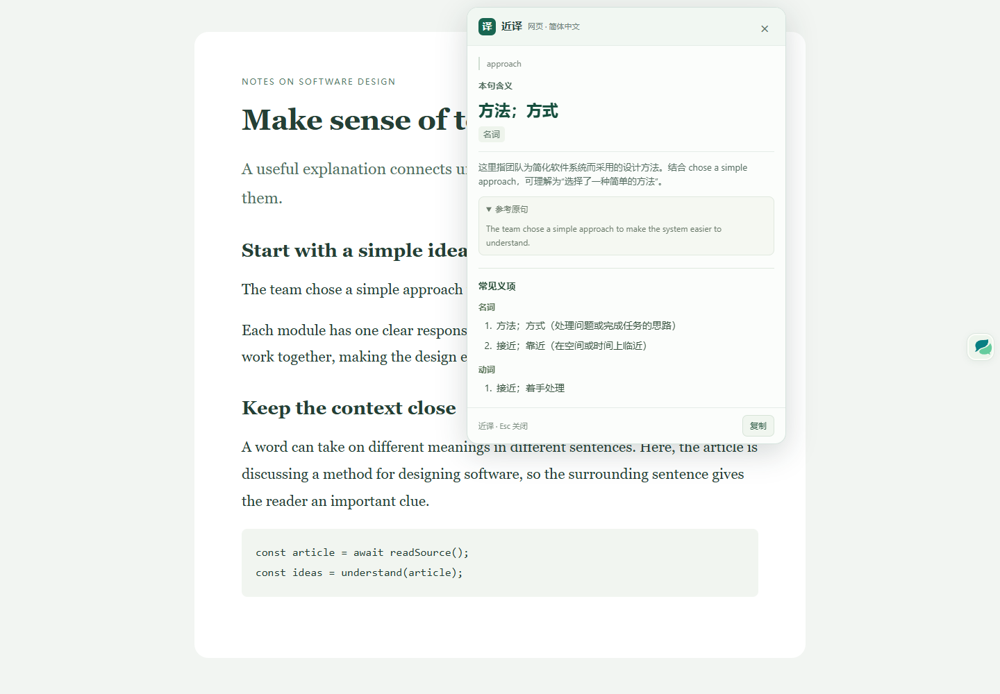

  

<h1 align="center">近译</h1>

<strong>读外文，留在文章里。</strong>

网页双语、语境查词与专注阅读，连成一个顺畅的阅读过程。

适用于 Chrome / Edge 的开源阅读翻译扩展 · MIT

**[下载 v0.11.4](https://github.com/FKstack/near-translate/releases/tag/v0.11.4)** · [项目主页](https://fkstack.github.io/near-translate/) · [开始使用](#开始使用) · [篡改猴版](docs/guides/USERSCRIPT.md) · [阅读体验](#让一篇外文更容易读下去) · [使用指南](docs/guides/INSTALL.md) · [参与改进](CONTRIBUTING.md)

读英文技术文章时，遇到生词就地查，遇到长句看拆解，需要整篇理解时打开双语对照。近译把这些帮助放在你正在读的地方，让你接着读下去。

*当前版本界面演示；文章与译文为预置示例内容。*

## 让一篇外文更容易读下去

### 保留原文，理解更有把握

读技术文档、产品文章或外文长文，在段落下方查看译文，随时回看原句、术语和代码。进入阅读模式，还可以切换原文、双语或仅译文，按自己的节奏读。

需要时点击翻译，过程中随时停止；已完成的内容留在当前页面，继续阅读不必从头开始。

### 查这个句子里的意思，再往下读

同一个词，在不同句子里可能是不同意思。开启上下文后，选中英文单词，就能查看它在当前句子里的含义、词性与解释，并参考常见义项。遇到英文长句，还能查看句子主干、语法标注和分块阅读提示。

*词卡使用预置示例响应展示。英语词典与长句拆解需要模型模式；词典支持英译简／繁中文，长句拆解目前支持英译简体中文。*

### 长文章，按你舒服的方式读完

一键进入阅读模式，让正文、目录和阅读进度集中在一起。从「舒适长读」「技术文档」「夜间阅读」开始，再调整字号、行距、栏宽和主题。喜欢的排版可以保存为「我的样式」，下篇文章继续用。

代码、表格、图片与列表也留在阅读内容中。读到一半想回原页，可以返回对应段落；按 `Esc` 退出阅读模式。

### 换成 PDF，也能顺手查词

用近译阅读器打开本地或在线文字型 PDF，翻页、搜索、缩放，选中文字后使用同样的翻译卡片。读文章和读 PDF，都能沿用你选择的翻译服务。

还有一套本地文档工具：把 Markdown／文本／HTML 导出为带文字层的 PDF，或合并、拆分、重排 PDF。文档转换在本机完成。[查看文档工具](docs/reports/PDF_CONVERSIONS_2026-10-23.md)

## 翻译方式，由你选择

| 你想怎么用 | 可以选择 |
| --- | --- |
| 先试试网页与句段翻译 | 实验性 DeepL 免费服务，无需 API Key；可能限流或调整。 |
| 使用自己熟悉的模型 | DeepSeek、OpenAI、Gemini、Qwen 等兼容服务，自带 Key，按所选服务的额度计费。 |
| 连接本机模型 | Ollama，使用已部署的模型和兼容接口。 |

普通文本翻译提供 16 种源／目标语言选项，源语言也可自动识别。模型服务、语言方向与配置方法见[使用指南](docs/guides/INSTALL.md)。

**先阅读，需要时再翻译。** 本地阅读无需登录或 Key；点击翻译后，所选正文或选区及可选上下文发送至你选择的服务。模型 Key 保存在浏览器扩展或篡改猴的本机私有存储中，填入保存后即可使用；正文、译文和 PDF 不持久化。[了解数据去向](docs/guides/PRIVACY.md)

## 开始使用

### 通过篡改猴安装网页阅读版

仓库也提供 Tampermonkey（篡改猴）版本，保留网页双语翻译、划词与阅读模式，已发布到 [Greasy Fork](https://greasyfork.org/zh-CN/scripts/601973)，也可通过 GitHub Pages 安装。PDF 阅读器和文档转换继续使用下面的扩展版；同一网站请只启用一种近译安装方式。

打开 [Greasy Fork 安装页](https://greasyfork.org/zh-CN/scripts/601973)点击安装，或选择 [GitHub 分发安装页](https://fkstack.github.io/near-translate/userscript/)；在专用设置页填入模型 Key 并保存，各网页即可直接翻译。模型配置见[在线使用指南](https://fkstack.github.io/near-translate/userscript/guide.html)。

从 0.11.4 起，主动使用阅读或翻译时发现新版会提示更新；取消后下次使用再提醒。想每次都自己决定，需在篡改猴中关闭近译的内建自动更新。旧版需先手动升级一次；检查缓存和 Greasy Fork 同步可能造成延迟。[更新说明](docs/guides/USERSCRIPT.md#更新提醒与安装) · [维护者发布流程](docs/development/RELEASE_WORKFLOW.md)

### 1. 安装到 Chrome 或 Edge

从 [v0.11.4 Release](https://github.com/FKstack/near-translate/releases/tag/v0.11.4) 下载对应安装包，无需安装 Node.js 或构建源码：

| 浏览器 | 下载 ZIP | 扩展管理页 |
| --- | --- | --- |
| Chrome | [near-translate-chrome-v0.11.4.zip](https://github.com/FKstack/near-translate/releases/download/v0.11.4/near-translate-chrome-v0.11.4.zip) | `chrome://extensions` |
| Edge | [near-translate-edge-v0.11.4.zip](https://github.com/FKstack/near-translate/releases/download/v0.11.4/near-translate-edge-v0.11.4.zip) | `edge://extensions` |

1. 将 ZIP **解压到长期保留的固定文件夹**。
2. 打开对应扩展管理页，开启「开发者模式」，点击「加载已解压的扩展程序」。
3. 选择**直接包含 `manifest.json` 的文件夹**，再把「近译」固定到工具栏。

ZIP 不能直接加载；安装后请保留该文件夹。详细步骤、已有用户升级和校验方法见[安装指南](docs/guides/INSTALL.md)。开发者可按[源码构建说明](docs/guides/INSTALL.md#从源码构建开发者)安装。

### 2. 打开一篇你想读的文章

点击扩展图标 →「阅读当前网页」。页面已加载近译后，也可按 `Alt+Shift+R` 进入阅读模式。先选一个喜欢的阅读样式，就可以开始读。

### 3. 需要理解时，再开启翻译

在「翻译设置」启用免费翻译，或配置自己的模型 API，并按浏览器提示授权。然后点击「翻译正文」，或选中文字后点击「译」。

完整安装、升级和 PDF 打开方式见[安装与使用](docs/guides/INSTALL.md)。免费服务限流后提供手动重试；扫描版 PDF 需先有 OCR 文字层，当前 PDF 翻译针对所选文字。

## 一起把阅读体验做好

如果近译帮你读完了一篇原本难以读下去的文章，欢迎分享使用感受。遇到问题时，告诉我们页面、复现步骤和期望的表现；提交截图前请遮盖私人内容与 Key。

[贡献指南](CONTRIBUTING.md) · [开发与文档](docs/README.md) · [轻量化实测](docs/reports/LIGHTWEIGHT_AUDIT_2026-10-23.md)

近译以 [MIT 许可证](LICENSE) 开源，字体与依赖许可见[第三方声明](THIRD_PARTY_NOTICES.md)。
