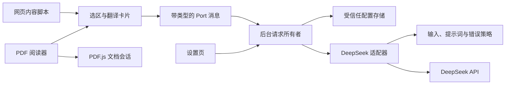

# 架构与实施记录

## 决策

- 架构风险 R2：新增浏览器执行环境、持久化配置与可取消的异步请求。
- WXT + TypeScript + React + Manifest V3；PDF.js 负责 PDF 的页面、文字层与渲染资源。
- 默认 DeepSeek `deepseek-flash` 非思考模式，目标语言简体中文。
- 网页与 PDF 复用选择控制器、浮层和翻译契约；PDF 文件留在阅读器，不经翻译后台传输。
- 内容脚本只负责 UI 和选区快照；后台负责凭证、请求生命周期与错误路由；provider 负责外部协议；core 为不依赖浏览器或 React 的纯逻辑。
- TranslationProvider 是外部服务与测试边界，不引入通用插件系统、事件总线或 DI 容器。
- API Key 仅由受信任扩展上下文保存读取。网页仅取得无凭证设置，设置不进入 Git。
- 活动请求由后台持有 AbortController，按 Port 和 requestId 隔离；新选区、关闭、导航与断开取消，迟到事件丢弃。
- HTTP(S) 网页权限在首次启用时申请，内容脚本动态注册；PDF 内置阅读器不能注入，使用扩展阅读器。本地文件通过文件选择器读取。
- 输入上限 12,000 字符，额外上下文最多 600 字符；超限提示缩小选区，不静默截断。
- 首响应头 25 秒、无网络数据 30 秒、总请求 90 秒，活动 Port 每 15 秒心跳；前台 95 秒保护。

## Git 阶段

1. main：说明与忽略规则基线。
2. feat/selection-translation：骨架、契约和配置。
3. 网页与 DeepSeek 翻译。
4. PDF 阅读器。
5. 测试、安装说明、打包与验证记录。

## 模块依赖与数据路径

`core` 只依赖共享契约；`providers` 依赖 core 与契约；selection 不导入凭证存储、provider 或 PDF 具体实现。`npm run check:boundaries` 对这些方向执行检查。WXT 入口是装配点，不引入全局服务定位器。

## 稳定契约

`TranslationInput` 为 `{ text, context?, kind: 'word' | 'text' }`。`TranslationProvider.translate(input, signal)` 返回 `AsyncIterable<TranslationEvent>`，事件为文本增量 `delta` 与经过校验的最终 `result`。单词结果含 `translation`、`partOfSpeech`、`explanation`；文本结果含 `translation`。

跨执行环境消息另加 `requestId`，控制消息为 `translate`、`cancel`、`heartbeat`，后台响应为 `started`、`delta`、`result`、`error`。网页不传 API URL、Key、系统提示词或任意 fetch 参数，后台从配置快照构造固定官方请求。

新增翻译服务时，在 `src/providers` 实现上述接口，在后台装配处根据明确的配置选择实现，并扩展设置页与该服务域名权限。单元测试注入 fetch；选区和卡片无需跟随服务协议修改。术语表等需求应进入翻译输入/提示词策略，PDF功能仍由PDF会话所有者管理。

## 所有权与失效处理

- 每个网页 frame 和 PDF 阅读器持有自己的选区、React root、Port 和活动 requestId。
- 后台的每个 Port 持有一个活动请求，拥有 AbortController 和 90 秒计时器，同时活动上限16。取消、新请求和断开使旧请求失效。
- provider 持有网络 reader、SSE缓冲、25秒连接期限和30秒数据空闲期限，所有退出路径释放计时器和 reader；后台重启不恢复请求、不重复计费。
- 前台只接收当前 requestId 的事件；15秒心跳仅在活动请求时存在，95秒超时保护避免永久加载状态。
- PDF 控制器拥有下载、loadingTask、密码回调、PDFDocument 与 viewer 事件。切换文档先失效旧会话并取消翻译，异步旧文件结果不能覆盖新文件。
- React管理PDF控制栏，PDFViewer独占阅读容器；核心、viewer、worker和解码资源版本保持一致。

## 凭证与权限

本地存储先设为 `TRUSTED_CONTEXTS` 才读取/保存 Key。`get-settings` 返回无凭证投影，写设置只接受扩展自身页面。Key不进入网页DOM、日志、Git或同步存储。

生产 manifest 只必选 DeepSeek官方域名，HTTP(S)网页为可选权限；授权后动态注册脚本。暂停或撤回授权时移除未来注入，并通知当前网页停止；PDF本地文件读取不需要`file://`权限。构建与测试检查生产manifest不会因框架自动生成而扩大权限。

所有模型输出用文本节点渲染，PDF文档脚本管理器未启用。PDF数据与密码仅在阅读器内存中处理；API只收到点击后选中的文本和有限上下文。
