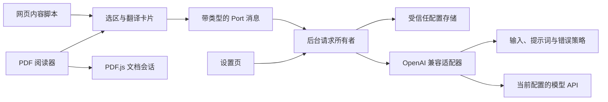

# 架构与实施记录

## 决策

### 0.7.0 多服务 OpenAI 兼容 API（R2）

沿用 `TranslationProvider.translate(input, signal)` 与前后台消息契约，将 Chat Completions / SSE 的网络实现归入 `providers/openai-compatible`；`providers/deepseek` 保留兼容入口。后台按受信任配置快照装配 provider，内容脚本、整页和 PDF 不感知服务商协议。DeepSeek 专有的关闭思考参数只在 DeepSeek 配置下发送，其他服务不会收到该参数。未引入生产依赖。

纯 `shared/api-config` 持有 DeepSeek、OpenAI、Gemini 官方兼容接口、百炼、Moonshot、硅基流动、OpenRouter、Ollama 和自定义接口预设，以及基址规范化、endpoint 和权限域计算。配置均可编辑；OpenAI Chat Completions 流式 SSE 是当前外部协议，不包含原生 Anthropic Messages 或 OpenAI Responses。Claude 可通过兼容网关或 OpenRouter 接入。JSON 模式按配置向词典和句法请求添加输出约束；无论是否启用，模型结果都经过原有结构校验。

`platform/settings` 继续唯一拥有凭证与配置，沿用 `settings:v1` 存储键，读取旧版扁平 DeepSeek 数据并投影为 `schemaVersion: 2`。每个 provider 保存一份 `{ model, baseUrl, jsonMode, apiKey }` profile，活动配置快照与 profiles 由同一次存储写入更新。保存操作串行化以避免多个设置页互相覆盖。保留空白 Key 仅在同服务且规范化基址相同的情况下发生，修改基址不会将旧凭证带到新 endpoint。`connectionRevision` 标识连接配置变化，使前台能区分模型和凭证上下文。

公开 `get-settings` 只返回当前服务标识、模型、开关、权限和是否有 Key 等无凭证字段，既不包含 API 基址，也不包含其他 profile。仅受信任扩展页面可调用 `get-connection-settings` 读取不含 Key 的连接配置；写入同样受后台发送者校验。实际请求的 URL、Key 和协议参数由后台决定，网页不能指定网络目的地。

基址必须是 HTTPS，仅本机回环地址允许 HTTP；拒绝用户名、密码、查询参数、片段和控制字符。设置页从保存手势申请对应 API 域名权限，后台再次校验配置与权限。生产 manifest 保留 DeepSeek 必选域名以兼容旧安装，其他 API 域通过可选 HTTP(S) 权限授权，网页注入仍取决于用户开启网页访问。

既有 Port、AbortController、SSE reader 和超时所有权不变，响应仍按 requestId 隔离。后台将完整保存、取消、广播事务串行化；连接配置变化或暂停时结束旧请求并发送安全终端错误，前台以连接修订号清理旧会话。删除 Key 和暂停允许在拒绝 API 域名权限时保存。仅关闭句法分析不改变连接修订号，保留普通译文。本轮协议测试使用模拟响应；未将预设等同于真实连通性、模型权限或质量验收。旧版本决策和验证结果保留为历史记录。

### 0.6.0 卡片语法彩色标注（R2）

`SentenceAnalysis.chunks` 兼容增补可选 `category`，只允许主语、谓语、宾语、从句、修饰和中性六类固定枚举。分类随原来的分析请求一起返回；提示词要求把主句谓语与后续从句分开，不为被动句虚构宾语。解析保留旧版缺失字段，纯 `normalizeGrammarCategory` 对旧 role 回退分类：从句优先，混合主干保持中性，不把模型任意字符串作为样式。

`ui/translator/sentence-highlights` 将已校验分块映射为原选中文字的区间，React 仅渲染原文切片，精确保留空白和标点。卡片原句与分块通过临时 `activeChunk` 双向点击和键盘定位，滚动限于卡片内部；网页 DOM 与原选区不修改。选区或分析更换时清除活动索引，已有「长难句拆解」开关关闭后同时移除拆解和全部色标。

本轮只扩展既有分析契约和卡片展示，没有新增 API 请求、配置字段、生产依赖、权限或 Key 存储；普通翻译、整页批处理与后台取消生命周期保持。

### 0.5.0 可选长难句拆解（R2）

`selection` 继续拥有选区与卡片生命周期，新增独立分析客户端，在正常句子译文成功后才发起 `task: sentence-analysis`；两路请求按各自 requestId 隔离，关闭、换选区、导航、暂停、撤权或销毁均取消。设置关闭时移除分析区域并取消在途分析，已返回译文保留；仅分析失败时独立重试，不重新翻译。整页模块从不传入该 task，批量并发配置不变。

新增纯 `core/sentence-analysis` 判断英文单句资格并校验结构，selection 对 core 增加单向依赖，边界门禁已同步。输入保持 kind 为 text，兼容增补 task，拒绝和 word/pageSegments 混用；分析最多 2,000 字符、至少 6 个英文词且只含一个句段。provider 以 JSON 格式单独请求主干、分块和阅读顺序，完整解析前不向 UI 发送原始 JSON；分块必须按原文顺序覆盖原始单词，主干必须使用有序原词。失败只产生分析错误，不能替换正常译文。

`analysis` 是独立终端事件，不改变既有 word/text result。transport 在终端回调前释放活动状态、超时与心跳，新增事件沿用后台 AbortController、凭证和流清理。UI 使用文本节点展示并沿用卡片滚动、折叠及 ResizeObserver 定位，不执行模型 HTML；收到旧后台的意外普通 result 时转为分析格式错误，避免永久加载。

`settings:v1` 兼容新增 `sentenceAnalysisEnabled`，旧数据缺失时默认 true；旧设置客户端省略该字段时保留原值，Key 与其他设置不迁移。后台按受信任设置再次禁止关闭状态的分析。没有新增生产依赖或权限，原输入与普通翻译行为兼容。

### 0.4.1 主按钮恢复原文（R1）

仅调整 `PageBar` 已有按钮的动作路由：进行中调用 stop，非进行中且已有成功译文时调用原有 restore，否则调用 translate。恢复复用 mount 的 observer 断开、session reset 和译文节点清理，不新增状态、依赖、存储或生命周期。原批处理和并发参数保持。

### 0.4.0 整页批量加速（R2）

整页队列仍由 `PageTranslationSession` 唯一持有，调度改为最多 32 个 worker，每批目标 1,600 个英文字符、最多 16 项；超长段落拆成独立 part 并行请求，按原序重组。`page/batches` 只负责容量常量和无损分片。前台完成态由合法段落事件驱动，正文位置不依赖网络完成顺序；批次中途失败保留已完成 part，仅对缺失项手动重试。

原 `TranslationInput` 兼容增补 `pageSegments?: string[]`，仅 `kind: text` 可用；后台重新规范化并校验最多 16 项、总计 12,000 字符。provider 采用独立的简短 NDJSON 提示词，纯 `PageBatchDecoder` 按 id 校验完整性、唯一性、边界与非空译文，合法完整行立即发 `segment` 事件；完整 SSE 与所有项校验通过才发带可选 `segments` 的 text result。原 word / text 协议保持，无新增权限、存储字段或依赖。

后台全局活动请求上限从 16 提到 64，给单页 32 路并发及独立划词保留空间。终端事件后微任务复用 Port，取消 / 重载 / 导航 / reset 继续以代次隔离过期回调，已有 reader、心跳和超时清理保持。NDJSON 行按惰性迭代解析，同一个网络增量内后续坏行不会撤销此前合法项。速度依靠减少请求波次与并行，输出预算保留全文余量，不缩写或省略译文。

实测及复现见 [性能记录](PERFORMANCE.md)。

### 0.3.0 整页对照（R2）

新增 `page` 模块：`segments` 只读提取段落和失效检测，`session` 拥有有界队列、同文缓存和两个前台 worker，`render` 只拥有插入的中文节点，`mount` 装配悬浮栏与 MutationObserver。原网页 DOM 由网站持有，不替换、不包裹。译文通常在对应段落内插入；flex/grid 文字块在安全的流式父容器中改放原块后方，避免原译并排。Shadow DOM 隔离网页样式，模型输出始终写入文本节点。

原 `selection/client` 的 Port 生命周期实现迁至 `platform/translation-client`，原路径保留重导出；整页和划词各持自己的客户端，复用同一个后台 / provider 契约和原 DeepSeek 配置。没有新增生产依赖、持久化字段或权限。边界门禁新增 `page`，仅允许 `selection` 和 `page` 依赖指定的无凭证 transport，不能导入配置存储或 provider。

点击后采集标题、段落、列表和表格，保留行内代码字面值供语义翻译；代码块、图片、编辑器、隐藏、编辑区、`translate=no`、主要为中文内容和 iframe 均跳过。仅主文档显示整页翻译栏，原 iframe 划词功能保持。每次最多接受 1,500 个段落 / 更新，文本超过 12,000 字符时无损分块并合并结果。队列只在用户明确点击后启动，动态新增内容由该会话继续处理；错误不自动重试，鉴权、余额、限流、配置或连接中断停止队列。

每次启动、停止、恢复原文和销毁都会使旧代次失效。写入前验证原始节点与文本快照；原文更新或移除时清理旧译文。观察器由 mount 持有，停止 / 撤权 / 导航 / 销毁时断开；恢复原文释放队列、缓存和节点引用，销毁同时释放两个 Port。已有 Key 和选词协议保持兼容。

- 架构风险 R2：新增浏览器执行环境、持久化配置与可取消的异步请求。
- WXT + TypeScript + React + Manifest V3；PDF.js 负责 PDF 的页面、文字层与渲染资源。
- 默认 DeepSeek `deepseek-flash` 非思考模式，目标语言简体中文。
- 网页与 PDF 复用选择控制器、浮层和翻译契约；PDF 文件留在阅读器，不经翻译后台传输。
- 内容脚本只负责 UI 和选区快照；后台负责凭证、请求生命周期与错误路由；provider 负责外部协议；core 为不依赖浏览器或 React 的纯逻辑。
- TranslationProvider 是外部服务与测试边界，不引入通用插件系统、事件总线或 DI 容器。
- API Key 仅由受信任扩展上下文保存读取。网页仅取得无凭证设置，设置不进入 Git。
- 活动请求由后台持有 AbortController，按 Port 和 requestId 隔离；新选区、关闭、导航与断开取消，迟到事件丢弃。
- HTTP(S) 网页权限在首次启用时申请，内容脚本动态注册；PDF 内置阅读器不能注入，使用扩展阅读器。本地文件通过文件选择器读取。
- 输入上限 12,000 字符，额外上下文最多 600 字符；超限提示缩小选区，不静默截断。
- 首响应头 25 秒、无网络数据 30 秒、总请求 90 秒，活动 Port 每 15 秒心跳；前台 95 秒保护。

## Git 阶段

1. main：说明与忽略规则基线。
2. feat/selection-translation：骨架、契约和配置。
3. 网页与 DeepSeek 翻译。
4. PDF 阅读器。
5. 测试、安装说明、打包与验证记录。

## 模块依赖与数据路径

`core` 只依赖共享契约；`providers` 依赖 core 与契约；selection 不导入凭证存储、provider 或 PDF 具体实现。`npm run check:boundaries` 对这些方向执行检查。WXT 入口是装配点，不引入全局服务定位器。

## 稳定契约

`TranslationInput` 为 `{ text, context?, kind: 'word' | 'text' }`。`TranslationProvider.translate(input, signal)` 返回 `AsyncIterable<TranslationEvent>`，事件为文本增量 `delta` 与经过校验的最终 `result`。单词结果保留 `translation`、`partOfSpeech`、`explanation` 作为语境义，0.2.0 新增必需的 `senses: WordSense[]`，每项含 `partOfSpeech` 与 `meaning`；文本结果仍含 `translation`。

词典升级风险为R2，变化集中在既有结果契约和展示，未增加生产依赖。provider验证1–10个有效义项并去重；提示词要求不同常见英文含义而非中文近义换词，无上下文不假装确定本句意义。卡片按词性分组，保留所有返回义项，复制由独立纯格式函数处理；卡片展示的上下文与实际发送内容保持一致。结果仅在请求内存中存在，配置不迁移，后台/前台原位更新后刷新网页启用新版卡片。

跨执行环境消息另加 `requestId`，控制消息为 `translate`、`cancel`、`heartbeat`，后台响应包括 `started`、`delta`、`segment`、`result`、`analysis`、`error`。网页不传 API URL、Key、系统提示词或任意 fetch 参数，后台从受信任配置快照构造当前服务的请求。

新增 OpenAI 兼容服务时，在 `src/shared/api-config.ts` 添加带明确协议能力的预设，并补充配置、请求参数、权限和凭证隔离测试；也可直接使用自定义接口。独立协议需在 `src/providers` 实现现有接口并在后台装配，不应将协议分支放入选区或卡片。单元测试注入 fetch；选区和卡片无需跟随协议修改。术语表等需求进入翻译输入/提示词策略，PDF 功能仍由 PDF 会话所有者管理。

## 所有权与失效处理

- 每个网页 frame 和 PDF 阅读器持有自己的选区、React root、Port 和活动 requestId。
- 后台的每个 Port 持有一个活动请求，拥有 AbortController 和 90 秒计时器，同时活动上限64。取消、新请求和断开使旧请求失效。
- provider 持有网络 reader、SSE缓冲、25秒连接期限和30秒数据空闲期限，所有退出路径释放计时器和 reader；后台重启不恢复请求、不重复计费。
- 前台只接收当前 requestId 的事件；15秒心跳仅在活动请求时存在，95秒超时保护避免永久加载状态。
- PDF 控制器拥有下载、loadingTask、密码回调、PDFDocument 与 viewer 事件。切换文档先失效旧会话并取消翻译，异步旧文件结果不能覆盖新文件。
- React管理PDF控制栏，PDFViewer独占阅读容器；核心、viewer、worker和解码资源版本保持一致。

## 凭证与权限

本地存储先设为 `TRUSTED_CONTEXTS` 才读取/保存 Key。`get-settings` 返回无凭证且无基址/profile 的公开投影；受信任扩展页面可读取不含 Key 的连接配置，写设置只接受扩展自身页面。Key 不进入网页 DOM、日志、Git 或同步存储。

生产 manifest 保留 DeepSeek 官方必选域名，其他 API 域名和 HTTP(S) 网页使用可选权限。设置页保存时申请目标 API 域名；开启完整网页访问后动态注册内容脚本。暂停或撤回网页授权时移除未来注入，并通知当前网页停止；PDF 本地文件读取不需要 `file://` 权限。构建与测试检查生产 manifest 不会因框架自动生成而扩大权限。

所有模型输出用文本节点渲染，PDF 文档脚本管理器未启用。PDF 数据与密码仅在阅读器内存中处理；API 收到主动翻译的文本、可选有限上下文，整页模式启动后也会继续接收动态新增的段落，直到停止或恢复原文。详见 [隐私说明](PRIVACY.md)。
