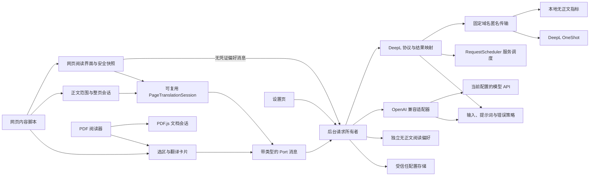

# 架构与实施记录

## 0.11.1 商店版密钥库（2026-10-23）

`platform/settings` 继续独占设置、凭证迁移和串行写队列；运行时配置保持既有接口，持久配置升级为仅非秘密字段的 schema 3。`platform/key-vault` 使用浏览器原生 WebCrypto 实现 PBKDF2-SHA-256 与 AES-256-GCM，负责严格包络校验、随机盐/IV、认证上下文及服务地址绑定，不引入加密依赖。

本机持久存储只保存密文和非秘密配置；派生钥匙仅进入 `TRUSTED_CONTEXTS` 的 `storage.session`，跨 worker 休眠保留，完整浏览器重启后丢弃。旧明文需用户设置口令迁移，先认证回读密文后再清理，冲突或故障保留可恢复材料，迁移前不提供旧 Key 给模型。不能把等待迁移的旧数据表述为已经自动加密。

密钥库变更仅允许可信 `options.html` 发送，返回值白名单不含 Key、口令或密文。任何变更开始前终止模型在途及旧异步快照；DeepL 与本地阅读独立使用。创建密钥库不要求先授予翻译服务权限，已成功保存的库不因已知未授权服务同步错误而误报失败。API 主机权限改为全部可选。

当前验收与限制见[商店版证据](../evidence/store-readiness-2026-10-23.json)。下文保留历次实现记录。

### 第五轮：有界尾部填充与安全计数（R1）

页面session只对不超过16个待发单part组启用尾部填充：没有待发可见正文、不是首包且不能一次全部装入时，保留现有首选anchor，其余按长度填入。已有顺序/fairness、loading状态、响应索引和取消所有权保持；没有Go专用规则或新公共契约。Provider仍拥有固定匿名协议与严格映射，调度器仍独占跨标签网络预算。HTTP诊断新增可选maxTextChars，仅为每次请求中最大文本长度，旧记录缺省保持缺省，OPTIONS不含此字段；不记录正文。未采用源语言强制提示、CLD生产检测或句子重切分，无新权限及依赖。

## 决策

### 0.11.0 常驻开销与离线资源减重（2026-10-23）

文档状态客户端移除每秒 IPC，以首订阅、显式刷新、恢复可见及可信后台广播更新；只接收三个公共状态字段，代次阻止旧响应覆盖新事件，末订阅释放监听。后台在共享冷却保存后广播，单个在途通知加一位待重放标记合并并发，不丢失慢接收者期间更新的截止时间；通知失败不改变翻译结果。

划词宿主保持原所有者与阅读层迁移，但样式、容器和 React 根首次展示才创建，关闭一起释放。入口组合根首次明确阅读才创建阅读控制器，模块代码仍静态包含。段落收集与 session 共用 1,500 段上限，最多预收 1,501 个完整快照；观察器过滤与正文根无关的普通区域变化，保持根替换、候选文章、祖先可见性及译文移除检测。

字体源改为 `third_party/fonts` 中的完整无损 gzip，构建生成本地字体资源与全部许可证；文档 PDF 所有者按需流解压、限制 32 MiB、支持取消且失败不缓存。PDF worker 使用同版本官方压缩产物，URL 不变。没有新增依赖、权限、持久化格式或远程资源。实测、测量边界及回归见[轻量化审计](../reports/LIGHTWEIGHT_AUDIT_2026-10-23.md)。

### 0.10.1 阅读翻译入口固定到顶部（R1，2026-10-23）

`ReadingView` 将原/双语/译文切换与翻译/停止操作移入固定阅读头部；正文不再放置操作条或闲置提示。仅有用的进度、错误及等待提示显示在头部状态区，失败重试邻近状态。桌面为一行，窄屏为两行，同一套按钮保持原回调与可访问名称。头部实际高度变化才通知既有布局提交机制，避免普通进度更新干扰滚动；抽屉与遮罩改以相对定位的正文布局为边界，自适应工具栏和状态区高度。打印隐藏完整头部。未改变模块依赖、IPC、持久化、翻译/取消所有权或资源生命周期。

`reading/mount` 的布局锚点保存源段落、段内比例与绝对屏幕坐标 `screenY`，头部状态区增高时仍保持同一阅读点；普通排版及窗口变化仅在该点超出新视口时约束到可见边界。连接或语言变化清除译文前，改为锁定当前专注源块的顶部，避免译文移除造成块高度缩短后按旧比例定位；该源块顶部允许位于视口上方。锚点沿既有布局提交应用，继续检查文档代次、节点连接及文章所有权，关闭与主动目录跳转仍清除旧锚点。

### 0.10.0 阅读自定义与可恢复调整（R2，2026-10-23）

`shared/reading` 统一拥有有限外观字段、场景方案、兼容归一化和单个个人样式；外观快照不含原/译模式，旧七字段偏好沿独立 `reading-preferences:v1` 自动补齐。`shared/reading-appearance` 计算排版变量和自定义配色，控件在派生背景上也保持可读对比度；`shared/reading-style-file` 定义版本 1、最大 16 KiB 的仅外观 JSON，严格拒绝已知字段的非法值和未知格式，丢弃正文、URL、Key 等额外字段。

`ReadingSettings` 管展示及用户显式触发的本地版式文件读取/下载，导入修订号及卸载清理阻止迟到导入；下载对象 URL 有界并释放。`ReadingView` 管面板响应式状态及 DOM 提交通知，不持有第二套持久化偏好。`reading/mount` 继续唯一持有偏好、上次外观快照、180 ms 保存合并、修订号、正文锚点和资源。后台 `ok` 决定保存回执；旧回执不覆盖新状态，离开/关闭尽力提交待保存快照。排版修正以源段落及段内比例瞬时恢复；主动目录导航清除旧锚点，避免回退。小屏抽屉在断点变化时解除 inert，正文无原生/手动双重锚定。

外观应用、恢复、撤销和文件搬迁不清译文、不切换三态模式、不触发翻译；模型设置与凭证所有权不变。没有新增依赖、权限、远程字体、云服务或持久化正文。详见[设计](../reports/READING_CUSTOMIZATION_DESIGN_2026-10-23.md)、[竞品研究](../reports/READING_CUSTOMIZATION_COMPETITIVE_ANALYSIS_2026-10-23.md)与[验证](../reports/READING_CUSTOMIZATION_VALIDATION_2026-10-23.md)。

### 单词释义的增量展示（R2，2026-10-23）

`core/word-preview` 独占纯 JSON 前缀解析，只在完整顶层字符串与合法分隔符到达后输出 `translation`、`partOfSpeech`、`explanation` 的累积快照；不输出原始 JSON、嵌套同名字段或未闭合字符串。Provider 在首个合法单词 SSE choice 到达时发送一次非终态 `progress`，再发送可选 `word-preview`；既有 `stop`、DeepSeek `[DONE]` 与完整词典 schema 校验仍唯一决定 `result`。普通文本、整页和句法分析保持原有事件顺序。

`selection/mount` 继续唯一持有卡片 view 和活动 requestId，网页、阅读与 PDF 共用该入口；预览沿用当前请求的取消、超时、设置失效与迟到事件隔离。UI 在生成中显示本句释义，最终结果才显示完整常见义项并允许复制；失败保留已展示预览，重试清空。没有新增持久化、权限、第三方依赖、网络请求或后台队列。输出仍受 Provider 的 100,000 字符限制；解析器生命周期属于单次 translate。详见[定位与验证](../reports/DEEPSEEK_SELECTION_LATENCY_2026-10-23.md)。

### 本地文档转换（R2，2026-10-23）

`conversion` 独占文档输入、HTML 清理与排版、PDF 文字布局、页面整理、图片编解码和 ZIP 导出。`entrypoints/convert` 仅装配 React 页面，popup / reader 通过导航打开；转换不导入翻译服务、存储、设置或后台协议，不读取模型 Key，不新增权限。依赖边界脚本限制该模块的内部引用只指向自身。复用现有 PDF.js 离线 worker、CMap、字体与解码资源，新增精确依赖 Marked 18.1.1 与 pdf-lib 1.17.1。

转换函数接收 `AbortSignal` 与进度回调，所有者负责销毁 PDF loading task、取消渲染、释放 canvas 和结果 URL。UI 以递增任务标识阻止取消或切换后的迟到结果。Markdown 使用惰性 HTML 模板解析与白名单清理，外链图片不自动加载；本地图片内嵌到 HTML。PDF 页面按源文件批量复制以共享图片和字体资源，重复选页仍持有独立页面字典。详细契约、限制和验收见[转换说明](../reports/PDF_CONVERSIONS_2026-10-23.md)。

直接 PDF 下载仍为 R2，独立由 `conversion/document-pdf` 拥有字体、临时布局 iframe、分页与 PDF 原生绘制；HTML 清理继续归 `markdown`，UI 不处理字形和几何。新增精确依赖 `@pdf-lib/fontkit` 1.1.1 及本地 OFL 中文 TrueType 字体，按需将实际用到的字形嵌入 PDF。浏览器只测量净化内容的布局，文档文字直接绘制为可搜索的 PDF 文字，不调用打印或把整页栅格化。源内图像使用局部 canvas 规范化并共享嵌入，canvas 与 iframe 在所有退出路径释放。字体字节只在页面内存缓存；不改翻译公共契约、设置格式、存储或权限。取消后不发布旧结果，下载由现有页面 Blob URL 触发，手动下载链接作为重试入口。

### 0.9.0 免费首译、多语言与手动恢复（R2，2026-10-22）

语言代码、显示名称、默认方向、内容文字筛选和英文学习能力集中在 `shared/languages`。源语言允许自动识别或 16 个明确选项，目标语言有同样 16 个选项；旧输入缺省仍为自动识别→简体中文。页面、阅读和划词复用同一契约，PDF 不把阅读器界面语言作为文档语言。页面节点快照同时保存不可变语言方向，异步回填重新验证时沿用该快照。Provider 根据输入快照构造请求，模型提示也按相同方向生成，不在 UI 内复制服务语言映射。

真实验收发现 DeepL 的繁→简方向可能返回原繁体字形。`core/chinese-variants` 是纯目标文字规范化组件，仅由 DeepL provider 在完整源段各分片按序合并后调用；最多惰性建立简/繁两个 converter，非中文目标原样返回，不在字块内提前转换以免丢失词组上下文。OpenCC JavaScript 1.4.2 的通用字形字典随包打入后台，不绑定地区词汇、不发额外请求，也不引入 UI 对字典的依赖。模型流式协议保持其现有目标提示，不为此复制全局翻译生命周期。许可与数据声明随构建复制，见[第三方声明](../../THIRD_PARTY_NOTICES.md)。

持久化仍由 `platform/settings` 独占，沿用 schemaVersion 2。只有从未保存设置的新用户默认 `deepl-web`；既有模型服务、Key、profile 和偏好保留。源/目标或服务变化推进 `connectionRevision`，取消在途工作并清理旧语言译文与缓存；阅读模式重建翻译会话，保留当前段落位置及本地阅读视图。网页与阅读共同依赖 `ui/translation` 的展示恢复组件，模块边界允许该单向展示依赖。

免费首译 UI 在用户手势内一次申请现有网页/DeepL 可选权限，后台只接收启用动作，在原保存队列读取最新设置后合并。`FreeTranslationCheck` 只在显式动作后发送固定公开英文例句，方向固定 en→zh-Hans；复用同一 DeepL provider 和预算，公开超时/取消不会提前释放仍在执行的唯一 owner。没有读取当前文章、Cookie 或 Key 的新入口。

冷却截止时间由调度器持有；provider 仅暴露读取状态，后台 IPC 不触发服务请求。`TranslationServiceStatusClient` 为一个文档的网页栏与阅读层共用，订阅期间可见页每秒刷新一次只读 IPC，末订阅释放时停止。展示组件只负责倒计时和手动按钮，时间到不自动发请求。完整设计、能力限制和真实验收见 [0.9.0 第一阶段记录](../reports/PHASE_ONE_FREE_SETUP_LANGUAGES_2026-10-22.md)。下方各版本记录保留其当时的默认语言、测试和协议约束；0.9.0 已将历史固定 `target_lang: 'zh-Hans'` 扩为所选目标，显式中文源映射 `zh`，自动源省略 `source_lang`。

### 0.8.0 本地网页阅读与双语衔接（R2，2026-10-22）

新增 `reading` 模块，复用原有 page session、翻译 transport、后台 provider 和服务调度。阅读本身无需登录、Key 或服务连接；入口为网页侧栏「阅读模式」、Popup「阅读当前网页」与 `Alt+Shift+R`，`Esc` 退出。Popup 可用既有 activeTab 授权向当前 HTTP(S) 标签页注入，不把本地阅读绑定到 API 配置。最终精修程序已完成回归、Chrome/Edge 构建及本机 Edge 原位安装，313 个程序文件哈希已核验；证据见[安装记录](../evidence/reading-mode-install-2026-10-22.json)，设计与验收见[阅读模式记录](../reports/READING_MODE_DESIGN_AND_VALIDATION_2026-10-22.md)。

`reading/extract` 只读网站，建立有界惰性副本后交给 Readability 0.6.0，通过节点 serializer 获取结果，再以严格标签/属性/HTTP(S) URL 白名单创建安全 DOM，不注入 HTML 字符串。article/main 语义回退用于解析失败或技术内容遗漏，超出复杂度上限时明确失败而不伪装为完整提取。文章包含安全 DOM、目录、元信息与 sourceMap；原节点仍由网站持有。运行时新增依赖仅 `@mozilla/readability`，`jsdom`/`@types/jsdom` 仅用于开发测试。

`reading/ReadingView` 管理工具栏、分级目录、阅读进度、主题/字号/字族/行距/栏宽、段落专注及三种原译文显示；`reading/styles` 隔离呈现。`reading/mount` 唯一持有 Shadow host、原生模态 dialog、React root、文章快照、原节点映射、滚动/焦点、源块/标题索引、单个待执行 RAF 及导航检测。关闭释放文章 DOM 与原节点引用，取消在途任务并恢复原页；普通关闭可保留当前文档内有界纯文本缓存和位置标识，导航、连接/权限变化及销毁清理。图片只在展示时赋予活动 src，可能正常联网加载，不把本地提取等同于全页面零网络。

`reading/translation` 拥有安全副本的 `PageTranslationSession`、原 Text.data 快照和译文 DOM 映射，只修改阅读副本。`page/session.translationSnapshot` 返回独立只读 Map 副本；`seedTranslations` 仅 idle 且未销毁时接收非空白字符串，沿用 1,500 项/2 MiB 缓存及淘汰，不把单请求 12,000 字符限制套到完整段落缓存。可选 `PageSessionCallbacks.isCurrent` 默认保持网页 `segmentIsCurrent`，阅读层以 root 包含关系、节点连接及原 Text.data 严格相等验证，避免自行隐藏原文被误判失效。三态显示只改变呈现，用户显式翻译才为未命中内容排队，继续共用原 provider 和 DeepL 429 保护。

原生模态 dialog 外部处于不可交互状态。`selection/mount` 通过 `onHost(host, close)` 向入口组合根提供既有划词宿主及关闭动作；`selection.content` 在阅读进出时先关闭卡片/请求，再把同一个宿主移入 dialog 或移回 documentElement。reading 只通知 `onSelectionPortal`，不导入 selection、不创建第二套划词客户端。内容脚本失效时依次释放 page、reading、selection 所有者，避免共享宿主随 dialog 移除而丢失。

`shared/reading` 只定义并规范化七项无正文偏好；`platform/reading-preferences` 通过独立 `reading-preferences:v1` 键、受限存储访问和串行写队列持久化，读取等待已排队写入；未知正文/URL/Key 字段丢弃，不读取模型设置。后台验证同扩展 id，只允许自身扩展页或 HTTP(S) 顶层内容脚本读写这些无凭证偏好。新 API 与数据所有权属于 R2；没有新增正文持久化、遥测、第三方翻译中转或独立服务协议。

### 可选DeepL连接准备（R2，第四轮）

Provider独占共享服务队列和prepare owner，platform独占固定HTTP/DNR/权限/会话时间戳；background装配并按browser sender持有发起文档所有权，独立早期脚本不读取正文。prepare没有TranslationEvent，普通翻译不await准备。五秒公开期限不会提前释放实际执行/响应清理槽，TTL拒绝不进入启动预算，429仍先暂停并保存冷却。无新运行时依赖、无模型设置迁移；接口兼容现有translate。详见 [第四轮设计与验收](../reports/DEEPL_PERFORMANCE_V4_2026-10-22.md)。

### 设置通知的有界等待（R2，2026-10-21）

`platform/web-access` 继续拥有设置广播；每个 runtime/tab 通知并行发送，最多等待 1,500 ms，成功、拒绝、同步异常和超时均清理定时器。广播仍属于尽力通知，不能让旧页面阻塞后台串行保存队列。脚本注册同步、持久化和权限语义不变。新增回归覆盖永不响应的接收者及迟到拒绝，不引入生产依赖。

### DeepL 匿名 OneShot 翻译（R2，2026-10-22）

新增独立 `translationEngine: model | deepl-web`，保持 ProviderId/API profiles 的含义与 schemaVersion 2；旧配置默认 model。`platform/settings` 仍唯一拥有持久化；选择 DeepL 不覆写模型 profile，切换推进 connectionRevision 并取消旧请求。公开设置按能力关闭额外上下文和句法分析，受信任设置页仍可读原偏好以便切回模型。

`providers/deepl-web` 拥有独立实现的匿名 OneShot 协议、严格结果解析、分段索引及安全错误映射，持有独立 `RequestScheduler`，使用构造注入的 transport；不引用浏览器、UI 或 platform。请求 body 仅为 `{ text: string[], target_lang: 'zh-Hans' }`，省略 source 语言以自动检测。同一次输入的分片按最多 32 项、合计 1,500 个 UTF-16 单元分批，请求体不超过 64 KiB，响应最多 1,000,000 字节。顶层 `translations[]` 数量与输入一致且每项 `text` 非空后，才按本地 `{ segment, part }` 映射发布完整段落；缺项、多项或无效项整批拒绝，不自动拆单补发。长段保留分片边界空白并按原序重组。协议不再使用 JSON-RPC ID/时间戳算法、备选译文参数、多个段落拼成 raw text 或自定义标记还原。

后台组合入口持有唯一 provider 实例，从 `shared/translation-policy` 装配 `maxConcurrent: 8`、`intervalMs: 100`、`maxQueuedRequests: 64`、`startWindow: { maxStarts: 30, durationMs: 12_000 }`；页面也读取同源并发策略。`providers/request-scheduler` 的通用 `RequestScheduler` 独立拥有该服务的有界 FIFO、在途槽、启动间隔计时器、有界 `recentStarts`、取消与冷却状态，并通过注入回调读取/保存冷却截止时间。provider 负责将调度失败映射为翻译错误，调度器不依赖浏览器、UI 或服务协议。所有网页、划词和 PDF 请求共享最多 8 个在途槽，相邻执行启动至少间隔 100 ms，滚动 12 秒最多启动 30 次，不能由多个标签页分别扩张全局预算。这是客户端保护策略，不是 DeepL 官方额度或服务端到达窗口；TLS 建连可能把分散的客户端启动聚成发送波次。

窗口只记录真正执行的启动时间，约束区间为 `(now - durationMs, now]`，当前最多保留 30 个启动时间戳。排队取消立即退出且不消费启动次数；已经启动的任务即使取消、失败或同步抛错也不退还计数。队列空闲和 429 不清空启动历史，记录按时间自然过期；`dispose` 清理时间戳、计时器和所属任务。不配置 `startWindow` 时兼容原来的并发与间隔行为，不添加窗口限制。在途取消后不发布迟到结果，底层执行及响应清理实际结束前不释放槽。429 后立即清空排队任务、取消其他在途请求，不自动重试，冷却至少 60 秒，并接受更长的 Retry-After；冷却状态与当前实例内存中的启动窗口是不同数据。

第五轮的通用尾部装包改进，使该Go网页从38次请求减少至37次，仍免登录、无需API Key。实际Edge全新标签页、无扩展译文缓存的一轮完成251段/53,505字符，37次HTTP200；首段正文1.420秒、初始4段1.863秒、全文14.295秒，导航到全文19.664秒。但同版本约94秒后再开新标签页，在第21请求429，仅完成118段。**全文10秒未达，429尚未可靠解决，不能把成功单轮当稳定保证。** 当前保留原8路/100ms/30次每12秒保护及已回归的装包改进；更激进候选均已撤下。研究、所有失败轮和限定结论见 [第五轮报告](../reports/DEEPL_PERFORMANCE_V5_2026-10-22.md)。 第31个正文启动仍受本地12秒窗口约束，不能把当前策略称为全文10秒方案。

先前18秒与14.8秒的窗口结果保留在 [第二轮](../reports/DEEPL_PERFORMANCE_V2_2026-10-22.md) 和 [第三轮](../reports/DEEPL_PERFORMANCE_V3_2026-10-22.md)。旧缓存重译不是新标签速度；上游缓存、负载和网络不受控，不保证长期相同耗时。可选元数据连接准备沿用第四轮；本轮未更改匿名正文预算、账号身份或模型Key。

`platform/deepl-web-transport` 拥有固定 `https://oneshot-free.www.deepl.com/v1/translate` 的 POST 传输及服务域名权限检查，使用 `credentials: omit`、`redirect: error`、`cache: no-store`。`Authorization: None` 是匿名哨兵，不是 Key；浏览器自行提供真实 Origin 与 User-Agent，不伪造官方扩展、设备或 app_information。内容脚本不能指定地址、请求头或服务凭证。后台在启动、权限变化及设置变化时同步可用状态，撤权或切换引擎使旧请求失效。

可选连接加速使用已声明的 `declarativeNetRequestWithHostAccess` 权限；设置页可以启用或关闭，历史已有该权限时显示为已启用。只有DeepL及网页/服务权限均开启时，顶层可见HTTP(S)非PDF文档在document_start发送不含正文/URL的准备消息。后台固定OPTIONS请求不含Cookie、API Key、正文或Referrer；规则74002只给自身固定地址OPTIONS加两个标准ACR协商头，不修改Origin、UA、POST或响应。准备可能在未点击时联系DeepL，正文仍只在点击后发送。所有标签共享至少30秒的准备调度预留间隔（不等于实际HTTP间隔），trusted session时间戳跨worker重启保留；5秒总期限含排队，取消及429复用共享调度器，普通POST不依赖此能力。没有新增必需权限或依赖包。

`platform/deepl-web-state` 保存可信会话中的冷却截止时间，通过 provider 构造参数将读取/保存回调交给调度器；不保存文本，切引擎不清零冷却，防止 MV3 后台休眠丢失限流状态。初始化读取或保存失败均停止请求，异步读取时排队仍可取消。

`page/session` 接受同源策略的有界调度参数，DeepL 为 8 个 worker、每批最多 32 项且目标合计 1,500 个 UTF-16 单元，数组预算不额外计算分隔符，仍受后台全局并发、启动间隔与滚动窗口约束；模型默认仍为每批 16 项、目标 1,600 字符、最多 32 路并发，保留按源顺序打包与单分隔符预算。共享输入契约最多接受 32 项、总计 12,000 字符；DeepL provider 再按自己的网络预算分片分批。译文继续使用现有 segment/result、取消、恢复原文和纯文本渲染契约。没有新增权限或运行时依赖。实验性服务不提供词典/句法能力，失败文案不引导用户填写无关 API Key。

`page/viewport` 只读原文 Text 的 Range 几何，输出可复用的优先级快照；译文节点不参与原文可见性测量。可见正文优先于标题、短品牌与链接密集目录，左右离屏或隐藏内容不算可见正文，但优先级不删除任何已采集段落。`page/session` 只重排未发送任务；有可见正文时，首批软目标为 800 字符、最多 2 项，完整且不超过硬上限的段落不因软预算拆小。后续 DeepL 批次按稳定 first-fit 填充余量；每第四批先选择最早等待的内容，避免滚动让旧内容一直等待。原始段落与响应索引显式关联，网络完成顺序不改变回填位置。

`page/mount` 拥有 scroll、resize、visibilitychange 监听与合并到 RAF 的刷新，初次启动和动态追加使用同一快照策略。会话持有源节点身份与排名，generation 拒绝旧快照；已发出的请求不因滚动重发。停止、恢复原文、导航或销毁清理监听与待执行 RAF。benchmark 直接复用正文采集和 viewport 函数，冻结点击时的合格可见正文身份，不另写可视区规则。

`page/segments` 在当前 document 内依次选择唯一可见 article、唯一可见 main，不能唯一确定时回退 body；初次采集和动态扫描使用同一范围。`page/session` 分别拥有 DOM 会话与纯文本译文缓存：缓存最多 1,500 项，原文与译文按 UTF-16 长度乘 2 估算的文字预算最多 2 MiB，按最近使用顺序淘汰，不包含 DOM 引用。恢复原文会取消请求、断开观察并释放会话节点引用，但保留缓存；同文重译可直接复用。导航、连接修订号或 engine 变化、暂停/撤回网页权限和销毁均清除缓存，不跨文档或连接复用，也不持久化。

`platform/deepl-web-transport` 另拥有当前后台实例的无正文指标：累计请求/条目/字数、并发、HTTP 状态、安全错误码与 fetch 起止时间，以及最多 256 条最近请求记录。`platform/network-timing` 可选读取本扩展固定 endpoint 的 Resource Timing，仅返回 DNS、连接、TLS、等待、下载、总耗时与限定协议名；不可用或不透明时省略，不增加网络请求、权限或运行时依赖。连接时间已包含 TLS，等待时间含网络往返与上游等待，不等同于模型计算时间；缺失或零值不能单独证明冷连接或热连接。

429 仍先暂停调度、启动冷却保存，再对错误体做最多 8 KiB / 1 秒的有界诊断读取；仅回传状态、可选数字错误码、等待时间与读取结果，组合入口最多保留 64 条，不保留错误体。诊断异常不会改变原来的限流或取消语义。后台只向受信任扩展页面响应 `get-translation-metrics`；这些指标不保留正文、译文或 Key，不写磁盘、不上传遥测，后台销毁后丢弃。fetch 等待时间不等同于全文完成或译文解析耗时。

协议来源、匿名合计 1,500 UTF-16 单元的官方客户端依据及静态证据边界见 [官方扩展核验](../evidence/deepl-official-oneshot-2026-10-22.md)。历史协议复现见 [OJBetter 复现与设计](../reports/OJBETTER_FULL_REPRODUCTION_AND_DESIGN_2026-10-21.md)，迁移状态见 [当前诊断](../reports/DEEPL_ANONYMOUS_PROTOCOL_DIAGNOSIS_2026-10-22.md)。

### 0.7.0 多服务 OpenAI 兼容 API（R2）

沿用 `TranslationProvider.translate(input, signal)` 与前后台消息契约，将 Chat Completions / SSE 的网络实现归入 `providers/openai-compatible`；`providers/deepseek` 保留兼容入口。后台按受信任配置快照装配 provider，内容脚本、整页和 PDF 不感知服务商协议。DeepSeek 专有的关闭思考参数只在 DeepSeek 配置下发送，其他服务不会收到该参数。未引入生产依赖。

纯 `shared/api-config` 持有 DeepSeek、OpenAI、Gemini 官方兼容接口、百炼、Moonshot、硅基流动、OpenRouter、Ollama 和自定义接口预设，以及基址规范化、endpoint 和权限域计算。配置均可编辑；OpenAI Chat Completions 流式 SSE 是当前外部协议，不包含原生 Anthropic Messages 或 OpenAI Responses。Claude 可通过兼容网关或 OpenRouter 接入。JSON 模式按配置向词典和句法请求添加输出约束；无论是否启用，模型结果都经过原有结构校验。

`platform/settings` 继续唯一拥有凭证与配置，沿用 `settings:v1` 存储键，读取旧版扁平 DeepSeek 数据并投影为 `schemaVersion: 2`。每个 provider 保存一份 `{ model, baseUrl, jsonMode, apiKey }` profile，活动配置快照与 profiles 由同一次存储写入更新。保存操作串行化以避免多个设置页互相覆盖。保留空白 Key 仅在同服务且规范化基址相同的情况下发生，修改基址不会将旧凭证带到新 endpoint。`connectionRevision` 标识连接配置变化，使前台能区分模型和凭证上下文。

公开 `get-settings` 只返回当前服务标识、模型、开关、权限和是否有 Key 等无凭证字段，既不包含 API 基址，也不包含其他 profile。仅受信任扩展页面可调用 `get-connection-settings` 读取不含 Key 的连接配置；写入同样受后台发送者校验。实际请求的 URL、Key 和协议参数由后台决定，网页不能指定网络目的地。

基址必须是 HTTPS，仅本机回环地址允许 HTTP；拒绝用户名、密码、查询参数、片段和控制字符。设置页从保存手势申请对应 API 域名权限，后台再次校验配置与权限。生产 manifest 保留 DeepSeek 必选域名以兼容旧安装，其他 API 域通过可选 HTTP(S) 权限授权，网页注入仍取决于用户开启网页访问。

既有 Port、AbortController、SSE reader 和超时所有权不变，响应仍按 requestId 隔离。后台将完整保存、取消、广播事务串行化；连接配置变化或暂停时结束旧请求并发送安全终端错误，前台以连接修订号清理旧会话。删除 Key 和暂停允许在拒绝 API 域名权限时保存。仅关闭句法分析不改变连接修订号，保留普通译文。本轮协议测试使用模拟响应；未将预设等同于真实连通性、模型权限或质量验收。旧版本决策和验证结果保留为历史记录。

### 0.6.0 卡片语法彩色标注（R2）

`SentenceAnalysis.chunks` 兼容增补可选 `category`，只允许主语、谓语、宾语、从句、修饰和中性六类固定枚举。分类随原来的分析请求一起返回；提示词要求把主句谓语与后续从句分开，不为被动句虚构宾语。解析保留旧版缺失字段，纯 `normalizeGrammarCategory` 对旧 role 回退分类：从句优先，混合主干保持中性，不把模型任意字符串作为样式。

`ui/translator/sentence-highlights` 将已校验分块映射为原选中文字的区间，React 仅渲染原文切片，精确保留空白和标点。卡片原句与分块通过临时 `activeChunk` 双向点击和键盘定位，滚动限于卡片内部；网页 DOM 与原选区不修改。选区或分析更换时清除活动索引，已有「长难句拆解」开关关闭后同时移除拆解和全部色标。

本轮只扩展既有分析契约和卡片展示，没有新增 API 请求、配置字段、生产依赖、权限或 Key 存储；普通翻译、整页批处理与后台取消生命周期保持。

### 0.5.0 可选长难句拆解（R2）

`selection` 继续拥有选区与卡片生命周期，新增独立分析客户端，在正常句子译文成功后才发起 `task: sentence-analysis`；两路请求按各自 requestId 隔离，关闭、换选区、导航、暂停、撤权或销毁均取消。设置关闭时移除分析区域并取消在途分析，已返回译文保留；仅分析失败时独立重试，不重新翻译。整页模块从不传入该 task，批量并发配置不变。

新增纯 `core/sentence-analysis` 判断英文单句资格并校验结构，selection 对 core 增加单向依赖，边界门禁已同步。输入保持 kind 为 text，兼容增补 task，拒绝和 word/pageSegments 混用；分析最多 2,000 字符、至少 6 个英文词且只含一个句段。provider 以 JSON 格式单独请求主干、分块和阅读顺序，完整解析前不向 UI 发送原始 JSON；分块必须按原文顺序覆盖原始单词，主干必须使用有序原词。失败只产生分析错误，不能替换正常译文。

`analysis` 是独立终端事件，不改变既有 word/text result。transport 在终端回调前释放活动状态、超时与心跳，新增事件沿用后台 AbortController、凭证和流清理。UI 使用文本节点展示并沿用卡片滚动、折叠及 ResizeObserver 定位，不执行模型 HTML；收到旧后台的意外普通 result 时转为分析格式错误，避免永久加载。

`settings:v1` 兼容新增 `sentenceAnalysisEnabled`，旧数据缺失时默认 true；旧设置客户端省略该字段时保留原值，Key 与其他设置不迁移。后台按受信任设置再次禁止关闭状态的分析。没有新增生产依赖或权限，原输入与普通翻译行为兼容。

### 0.4.1 主按钮恢复原文（R1）

仅调整 `PageBar` 已有按钮的动作路由：进行中调用 stop，非进行中且已有成功译文时调用原有 restore，否则调用 translate。恢复复用 mount 的 observer 断开、session reset 和译文节点清理，不新增状态、依赖、存储或生命周期。原批处理和并发参数保持。

### 0.4.0 整页批量加速（R2）

整页队列仍由 `PageTranslationSession` 唯一持有，调度改为最多 32 个 worker，每批目标 1,600 个英文字符、最多 16 项；超长段落拆成独立 part 并行请求，按原序重组。`page/batches` 只负责容量常量和无损分片。前台完成态由合法段落事件驱动，正文位置不依赖网络完成顺序；批次中途失败保留已完成 part，仅对缺失项手动重试。

原 `TranslationInput` 兼容增补 `pageSegments?: string[]`，仅 `kind: text` 可用；后台重新规范化并校验最多 16 项、总计 12,000 字符。provider 采用独立的简短 NDJSON 提示词，纯 `PageBatchDecoder` 按 id 校验完整性、唯一性、边界与非空译文，合法完整行立即发 `segment` 事件；完整 SSE 与所有项校验通过才发带可选 `segments` 的 text result。原 word / text 协议保持，无新增权限、存储字段或依赖。

后台全局活动请求上限从 16 提到 64，给单页 32 路并发及独立划词保留空间。终端事件后微任务复用 Port，取消 / 重载 / 导航 / reset 继续以代次隔离过期回调，已有 reader、心跳和超时清理保持。NDJSON 行按惰性迭代解析，同一个网络增量内后续坏行不会撤销此前合法项。速度依靠减少请求波次与并行，输出预算保留全文余量，不缩写或省略译文。

实测及复现见 [性能记录](../reports/PERFORMANCE.md)。

### 0.3.0 整页对照（R2）

新增 `page` 模块：`segments` 只读提取段落和失效检测，`session` 拥有有界队列、同文缓存和两个前台 worker，`render` 只拥有插入的中文节点，`mount` 装配悬浮栏与 MutationObserver。原网页 DOM 由网站持有，不替换、不包裹。译文通常在对应段落内插入；flex/grid 文字块在安全的流式父容器中改放原块后方，避免原译并排。Shadow DOM 隔离网页样式，模型输出始终写入文本节点。

原 `selection/client` 的 Port 生命周期实现迁至 `platform/translation-client`，原路径保留重导出；整页和划词各持自己的客户端，复用同一个后台 / provider 契约和原 DeepSeek 配置。没有新增生产依赖、持久化字段或权限。边界门禁新增 `page`，仅允许 `selection` 和 `page` 依赖指定的无凭证 transport，不能导入配置存储或 provider。

点击后采集标题、段落、列表和表格，保留行内代码字面值供语义翻译；代码块、图片、编辑器、隐藏、编辑区、`translate=no`、主要为中文内容和 iframe 均跳过。仅主文档显示整页翻译栏，原 iframe 划词功能保持。每次最多接受 1,500 个段落 / 更新，文本超过 12,000 字符时无损分块并合并结果。队列只在用户明确点击后启动，动态新增内容由该会话继续处理；错误不自动重试，鉴权、余额、限流、配置或连接中断停止队列。

每次启动、停止、恢复原文和销毁都会使旧代次失效。写入前验证原始节点与文本快照；原文更新或移除时清理旧译文。观察器由 mount 持有，停止 / 撤权 / 导航 / 销毁时断开；恢复原文释放队列、缓存和节点引用，销毁同时释放两个 Port。已有 Key 和选词协议保持兼容。

- 架构风险 R2：新增浏览器执行环境、持久化配置与可取消的异步请求。
- WXT + TypeScript + React + Manifest V3；PDF.js 负责 PDF 的页面、文字层与渲染资源。
- 默认 DeepSeek `deepseek-flash` 非思考模式，目标语言简体中文。
- 网页与 PDF 复用选择控制器、浮层和翻译契约；PDF 文件留在阅读器，不经翻译后台传输。
- 内容脚本只负责 UI 和选区快照；后台负责凭证、请求生命周期与错误路由；provider 负责外部协议；core 为不依赖浏览器或 React 的纯逻辑。
- TranslationProvider 是外部服务与测试边界，不引入通用插件系统、事件总线或 DI 容器。
- API Key 仅由受信任扩展上下文保存读取。网页仅取得无凭证设置，设置不进入 Git。
- 活动请求由后台持有 AbortController，按 Port 和 requestId 隔离；新选区、关闭、导航与断开取消，迟到事件丢弃。
- HTTP(S) 网页权限在首次启用时申请，内容脚本动态注册；PDF 内置阅读器不能注入，使用扩展阅读器。本地文件通过文件选择器读取。
- 输入上限 12,000 字符，额外上下文最多 600 字符；超限提示缩小选区，不静默截断。
- 模型 API 首响应头 25 秒、无网络数据 30 秒；两种引擎均受后台总请求 90 秒、前台 95 秒保护，活动 Port 每 15 秒心跳。总计时包含排队，多个标签页大量排队时可能超时，需要手动重试。

## Git 阶段

1. main：说明与忽略规则基线。
2. feat/selection-translation：骨架、契约和配置。
3. 网页与 DeepSeek 翻译。
4. PDF 阅读器。
5. 测试、安装说明、打包与验证记录。

## 模块依赖与数据路径

`core` 只依赖共享契约；`providers` 依赖 core 与契约；reading 的内部依赖限于 reading/page/shared，不导入 selection、凭证存储或 provider；selection 不导入凭证存储、provider 或 PDF 具体实现。`npm run check:boundaries` 对这些方向执行检查。WXT 入口是装配点，负责共享划词 host 的 portal 移交，不引入全局服务定位器。

## 稳定契约

阅读控制器提供 `open(translations?)`、`close()`、`dispose()`；输入为当前文档内的纯文本译文副本。Page session 新增只读 `translationSnapshot`、受 idle/销毁状态保护的 `seedTranslations` 与可选 `isCurrent`，原 start/cancel/reset、翻译消息和网络协议不变。偏好消息 `get-reading-preferences` / `save-reading-preferences` 只返回规范化的无凭证显示设置。

`TranslationInput` 为 `{ text, context?, kind: 'word' | 'text', pageSegments?, task? }`；整页分段最多 32 项、合计 12,000 字符，模型页面调度的默认批次仍为 16 项。`TranslationProvider.translate(input, signal)` 返回 `AsyncIterable<TranslationEvent>`，包括模型文本增量 `delta`、有索引的 `segment`、独立 `analysis` 与经过校验的最终 `result`。DeepL 不伪造流式增量，使用现有 segment/result 返回普通译文。单词结果保留 `translation`、`partOfSpeech`、`explanation` 作为语境义，0.2.0 新增必需的 `senses: WordSense[]`，每项含 `partOfSpeech` 与 `meaning`；文本结果含 `translation`，整页可附 `segments`。

词典升级风险为R2，变化集中在既有结果契约和展示，未增加生产依赖。provider验证1–10个有效义项并去重；提示词要求不同常见英文含义而非中文近义换词，无上下文不假装确定本句意义。卡片按词性分组，保留所有返回义项，复制由独立纯格式函数处理；卡片展示的上下文与实际发送内容保持一致。结果仅在请求内存中存在，配置不迁移，后台/前台原位更新后刷新网页启用新版卡片。

跨执行环境消息另加 `requestId`，控制消息为 `translate`、`cancel`、`heartbeat`，后台响应包括 `started`、`delta`、`segment`、`result`、`analysis`、`error`。网页不传 API URL、Key、系统提示词或任意 fetch 参数，后台从受信任配置快照构造当前服务的请求。

新增 OpenAI 兼容服务时，在 `src/shared/api-config.ts` 添加带明确协议能力的预设，并补充配置、请求参数、权限和凭证隔离测试；也可直接使用自定义接口。独立协议需在 `src/providers` 实现现有接口并在后台装配，不应将协议分支放入选区或卡片。单元测试注入 fetch；选区和卡片无需跟随协议修改。术语表等需求进入翻译输入/提示词策略，PDF 功能仍由 PDF 会话所有者管理。

## 所有权与失效处理

- 每个网页 frame 和 PDF 阅读器持有自己的选区、React root、Port 和活动 requestId。
- 顶层文档持有一个阅读控制器，关闭释放安全文章、sourceMap、原节点/文字快照、阅读 React root/dialog、滚动监听、RAF 和导航计时器；普通关闭只保留有界纯文本缓存与位置标识，连接/权限变化、导航与 dispose 清理。共享划词 host 由 selection 所有，进出阅读时由入口关闭旧卡片并移交 portal。
- 主文档的整页 session 持有 DOM 会话、未发送任务排名与有界纯文本缓存；恢复原文清理会话和排名，导航、连接变化和销毁同时清理缓存。mount 拥有可视区事件与 RAF，viewport 只计算原文几何快照。
- 后台的每个 Port 持有一个活动请求，拥有 AbortController 和 90 秒计时器，同时活动上限64。取消、新请求和断开使旧请求失效。
- 模型 provider 持有网络 reader、SSE 缓冲、25 秒连接期限和 30 秒数据空闲期限；DeepL provider 持有协议结果映射与有界响应 reader，其独立 RequestScheduler 持有共享队列、在途槽、间隔计时器、有界 recentStarts 和冷却生命周期。取消不退还已启动次数，空闲或 429 不重置窗口，dispose 清理所属状态；未配置窗口的调用方保持原行为。所有退出路径释放对应计时器和 reader；后台重启不恢复请求、不自动重发。
- 前台只接收当前 requestId 的事件；15秒心跳仅在活动请求时存在，95秒超时保护避免永久加载状态。
- PDF 控制器拥有下载、loadingTask、密码回调、PDFDocument 与 viewer 事件。切换文档先失效旧会话并取消翻译，异步旧文件结果不能覆盖新文件。
- React管理PDF控制栏，PDFViewer独占阅读容器；核心、viewer、worker和解码资源版本保持一致。

## 凭证与权限

本地存储先设为 `TRUSTED_CONTEXTS` 才读取/保存 Key。`get-settings` 返回无凭证且无基址/profile 的公开投影；受信任扩展页面可读取不含 Key 的连接配置，写设置只接受扩展自身页面。Key 不进入网页 DOM、日志、Git 或同步存储。

阅读偏好使用同样受限的本地存储，但经后台独立消息仅投影 theme/fontSize/lineHeight/width/fontFamily/mode/focus。正文、译文、sourceMap、URL 和阅读位置不写入该键。Popup 的阅读入口使用原有 activeTab 对当前页的授权；阅读翻译继续按公开设置确认原有网页与服务权限，不从页面接受网络地址或凭证。

生产manifest保留DeepSeek必选域名，其他API、DeepL与网页采用可选host权限；DeepL普通正文翻译只需host授权。连接准备额外使用已声明的可选DNR权限，设置页可启用/关闭；注册及所有者细节见上文和第四轮设计。暂停/撤权时移除未来注入、取消准备及活动翻译，原模型配置与Key不变。PDF本地读取不需要file权限。

所有模型输出用文本节点渲染，PDF 文档脚本管理器未启用。PDF 数据与密码仅在阅读器内存中处理；API 收到主动翻译的文本、可选有限上下文，整页模式启动后也会继续接收动态新增的段落，直到停止或恢复原文。详见 [隐私说明](../guides/PRIVACY.md)。
