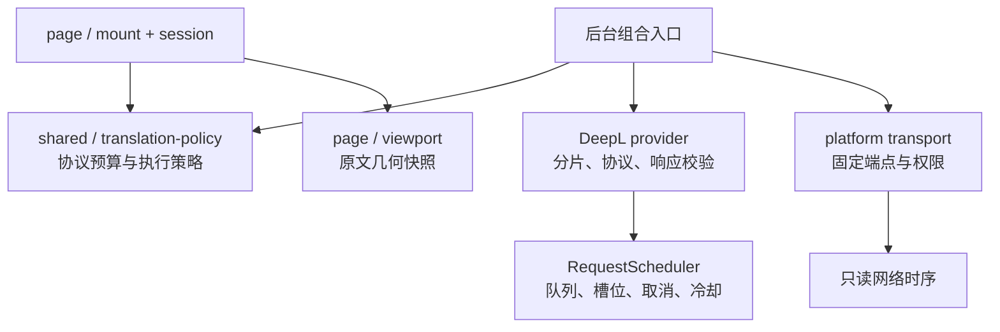

# DeepL 整页翻译继续优化：架构与验收

此文保留第二轮6路/350ms及18秒的历史时点。后续累计窗口策略已完整通过14.936/14.781秒，但10秒全文与稳定2秒首屏尚未达，当前实现见[第三轮研究与验收](DEEPL_PERFORMANCE_V3_2026-10-22.md)。

状态：已安装到用户实际 Edge，两个全新前台标签页完整通过。全文分别 **18.146 秒、18.429 秒**，每轮 251 段 / 53,505 字符 / 38 次 HTTP200 / 零失败。保持匿名、无需 API Key、Cookie 或代理；没有运行缓存重译，也没有把译文缓存计为提速。[数字时序及程序哈希证据](../evidence/deepl-speed-v2-go-2026-10-22.json)。

## 基线与瓶颈

上一轮实际 Edge 新标签页：251 段、53,505 原文字符、42 次 HTTP200，全文 29.330 秒。其首屏旧口径为 7.704 秒，但当时目标标签后台运行，候选集合又未严格匹配正文采集器；本轮改用前台标签和同一生产采集规则，旧首屏数值只保留为历史。

重新分解一次浏览器网络时序：首次公开段落请求 9.613 秒，其中 connect 7.884 秒（含 TLS 7.883 秒），发送后等待响应约 1.724 秒；第二次复用 HTTP/2 连接，1.344 秒。DNS/TCP 并非这次主要等待。这个隔离浏览器结果不冒称用户 Default profile 的全部请求；正式验收也会读取自身请求的可选数字时序。connect 包含 TLS，不能重复相加；响应等待不等于模型计算时间。

匿名官方扩展在没有登录 assignedCell 时使用现有 OneShot fallback，未找到可直接用于匿名的低延迟模型或区域开关。本轮不猜域名、借用账号资格或复制设备身份。隔离浏览器对公开段落做 auto/en 源语言对照，也没有稳定、足够显著的收益支持新增该设置。不会在计时前秘密发送翻译请求或将连接预热后的成绩称为完全冷连接。

## R2 架构决策

- **共享策略**区分官方匿名客户端的每包 1,500 UTF-16 / 32 项预算与近译自行选择的并发、节拍、首包和装包策略。后台和页面消费同一份数据；模型默认行为保留。
- **RequestScheduler**拥有一个服务的有界 FIFO、在途 Set、私有 AbortController、定时器、冷却加载/保存和销毁；不依赖 HTTP、DOM、浏览器或诊断文件。provider 保留 OneShot、Retry-After 解析、错误分类和完整结果校验，构造入口兼容。
- **页面会话**仍持有完整采集集合、段落映射及当前文档缓存。viewport 模块只测原文 Range 并返回数字排名；mount 持有滚动、resize、可见性监听和合并刷新。仅重排未发送任务，不修改在途请求索引；旧 generation 的快照无效。
- **网络层**保留固定目的地、真实浏览器身份、`credentials:omit` 和匿名标记。可选 Resource Timing 仅读自身固定端点的数字信息；不透明或缺失时省略，不影响翻译，不增加权限、网络请求或长期观察器。
- **测速工具**直接打包导入生产采集器与 viewport 策略，避免维护第二套正文定义。Vite 是既有 WXT 所用版本，本轮显式声明为开发依赖用于诊断 bundle；不增加产品运行时依赖。

## 候选策略与不变量

最终全局最多 **6 路在途、350 ms 最小调度启动间隔**，后台组合入口与页面从同一个共享策略读取，不改变每包硬预算。首个可见正文批采用 800 字符/最多2项软预算；超过软预算但不超过硬预算的完整段可单独发送。每第4批放行最旧等待任务，防止持续滚动使旧正文饥饿。后续可跳过当前放不下的大段，继续填小段余量；模型保留原顺序装包。这些是客户端策略，不是 DeepL 公布的额度。

源数据仅离线比较：顺序装包42次，稳定填充37次，字符总量均为53,505，理论字数下界36次。实际首屏优先方案两轮均为38次，相比旧42次减少4次。离线最少次数不等于更低的首屏延迟，也不将离线次数或时间线重放当作真实速度。

取消立即结束调用方等待，但底层 transport、reader 或 body.cancel 未真正结束时仍占槽。429先暂停服务、结束排队、取消同服务其余在途，再诊断并保存冷却；至少60秒且接受更长Retry-After，不自动重发。并发增加不表示匿名服务不限流，任何429立即停止该轮。

## 新标签页真实验收口径

默认只做冷页面轮，不调用恢复原文的缓存重译。确认目标精确URL、标签前台和可见后开始；记录导航、工具栏就绪、点击时刻、首个可见正文DOM就绪、下一可见帧、初始可见正文全部完成及全文完成。初始目标由生产采集器和原文几何冻结，不随译文插入后位移改变分母。

完整性必须同时验证全部采集段、源字符、实际译文节点、失败和待处理、真实请求和状态；完成后继续观察至少1秒，额外请求仍视为干扰。未清选区、未替换fetch、未缩短原文或使用预制译文。新页面没有扩展文档缓存；上游缓存和负载仍无法由客户端控制。

## 验证结果

测试使用原扩展 ID `dbdooijmbinjmnbmgglajigaoiinolnc`，原 Default profile，Edge 155.0.4283.62，精确 URL 为 `https://go.dev/talks/2012/splash.article?utm_source=chatgpt.com`。两轮都新建文档并发送全部原文；第二轮未重载扩展或更改配置。两轮均没有 `--warm`，没有预制译文、fetch 替换、选区修改或隐藏的翻译预热。

| 全新前台标签页 | 首个可见正文 DOM | 下一可见 RAF* | 初始可见正文全部完成 | 全文完成 | 完成 / 失败 / 待处理 |
| --- | ---: | ---: | ---: | ---: | --- |
| 最终策略，第一轮 | 3.186 秒 | **3.206 秒** | **3.913 秒** | **18.146 秒** | 251 / 0 / 0 |
| 同程序独立复测 | 4.169 秒 | **4.191 秒** | **4.519 秒** | **18.429 秒** | 251 / 0 / 0 |

时间从点击翻译计。* RAF 是下一可见帧的近似时点，不是操作系统实际绘制时间；初始4个可见正文目标在插入译文前冻结，不等于插入后不断变化的视口。导航开始到点击另外耗时5.133 / 3.924秒，因此导航到全文为23.279 / 22.353秒；没有把网页自身加载耗时隐藏在“从导航开始”口径中。

两轮均实际回填251个译文节点、成功提交251项/53,505字符，38次200、0个活动请求、0个错误、无源变化/映射冲突/额外译文。完成后继续观察约2秒，均无新请求。响应指纹不同允许成立，代表两次真实网络返回；不要求不同请求得到逐字相同译文。

与历史29.330秒的全文轮相比，本次实测用时缩短约37–38%，但两轮的上游缓存、负载和网络无法控制，不能把所有差值都归为代码收益。旧首屏7.704秒口径不同，不计算首屏倍率。两次正式首请求的 connect 分别1.865 / 1.911秒（包含TLS），发送后的响应等待约1.243 / 2.182秒；收到第一项结果后约数毫秒即可写入译文，当前首屏主要受网络及上游等待影响。

### 被淘汰的更激进方案

8路 / 100ms 的候选首正文下一帧2.780秒、初始可见正文3.250秒，但第32次请求返回429，**全文失败**。实际结果24次200、1次429、7次取消；182段完成，7失败、62待处理；成功输入34,581字符，不能把提交的46,508字符算成成功翻译量。429在点击后8.903秒返回，失败观察窗结束于10.966秒，后者不是全文时间。

收到429后立即停发，逐条数字时序独立确认429之后无新请求；等待本地冷却自然结束，再部署降低负载的策略。没有清冷却、变更身份/IP、换代理或自动重试。失败轮的测速工具 `lateRequestCount=0` 默认值没有被当作独立停发证据。保留该轮是为了明确更高并发没有通过可靠性验收，不能交付其较低的局部首屏数值。

### 框架、安装与回归

- 586/586单元测试、24/24定向Edge浏览器回归通过，TypeScript、模块依赖边界、差异检查及Chrome/Edge构建通过。浏览器回归使用模拟网络，仅验证行为。
- 单测覆盖独立调度器队列/槽/取消/冷却生命周期、完整预算和fill、正文几何/滚动优先级/每第4批公平性、旧代次失效、网络时序缺失降级；浏览器新增长目录前的可见正文优先，并继续验证全文、恢复原文、停止和撤权。
- 只读DOM复核第二个已完成标签页：251原文/251译文、唯一翻译栏，28个pre及176个code中均0译文。5个无汉字输出为原样保留的品牌/域名。没有将节点数量核验冒称全文人工译文质量审校。
- 已原位更新实际加载目录 `artifacts/installed/near-translate-edge-v0.1.0`（文件夹名为历史名称），运行版本仍为0.7.0；manifest/background/content脚本哈希与最终Edge构建一致，模型配置和Key保留。新增测速临时文件已清理，未申请新权限。旧发布ZIP未重新生成，不代表本次程序。

这是本次有限实验中完整通过的最快配置，并非所有网络、页面或匿名服务额度下的数学最优。后续服务商可复用调度器和页面策略契约；无需把协议、DOM和队列重新耦合，也没有为Go URL写特殊路径。
