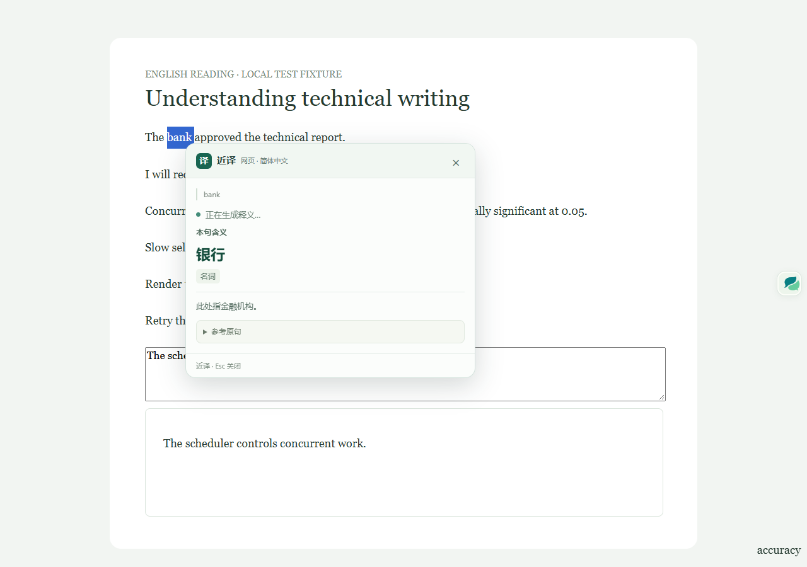

# DeepSeek 划词等待定位与修复

日期：2026-10-23（Asia/Singapore）。实际环境为用户日常 Edge 155.0.4283.62，原安装 0.9.0，模型 `deepseek-flash`。保留用户已有未提交改动。

## 定位结论

已确认两项相互关联的问题：

1. `providers/openai-compatible` 虽然请求 SSE，但单词结果一直缓冲到本句词义、词性、解释和所有常见义项生成结束，再校验完整 JSON 后一次发布。生成中的本句词义无法提前使用。
2. `Translator` 根据普通文本 `streamed` 是否为空区分连接与翻译。单词从来不发送普通文本 delta，因此整个词典生成过程都被标为“正在连接翻译服务…”。

点击处理直接启动 Port 请求。实际公开样例的后台 `started` 事件仅约 2 ms；这不是网络首字时间，但说明本轮没有明显的本地点击排队。DeepSeek 请求已使用 `thinking: { type: 'disabled' }`，没有代码内自动重试，也不经过仅适用于 DeepL 的 RequestScheduler。上下文最多 600 字符；长难句分析在普通译文完成后独立开始。

整页模型翻译的 32 路并发可能与划词争用浏览器或上游资源，但本轮没有证据证明它造成此次异常，未据此改动并发策略。三次现场请求没有复现用户描述的特别长等待，不能把所有偶发延迟归因于已确认的 UI/缓冲问题。DeepSeek 官方也说明流式请求在等待期间可能收到 SSE keep-alive；真实服务端等待仍可能存在：[官方等待机制说明](https://api-docs.deepseek.com/quick_start/rate_limit/)。当前非思考参数符合[官方说明](https://api-docs.deepseek.com/guides/thinking_mode/)。

## 修复行为

- 提示模型优先生成本句词义、词性、解释，再生成常见义项，不减少词典信息。
- 单词请求收到首个合法模型 SSE choice 后发送一次 `progress`，包含角色事件；心跳与空 usage 事件不算模型响应。界面据此进入“正在生成释义…”。
- `WordPreviewDecoder` 只解析完整顶层字符串字段，在合法逗号或对象结束处发布 `word-preview` 累积快照。支持分块字符串、JSON 转义和任意字段顺序；嵌套同名字段、未闭合字符串和原始 JSON 不进入 UI。
- 本句词义可先展示。常见义项和复制仍等待完整 schema、`stop` 与 DeepSeek `[DONE]` 校验。截断、格式错误或取消都不会把预览升级成成功结果。
- 新选择、重试、关闭与设置变化继续通过既有 requestId/AbortSignal 隔离迟到事件；错误保留已展示预览并显示失败原因。

## 实际安装测量

固定公开单词 `scalable`，上下文为 `Go is efficient, scalable, and productive.`。每个条件仅一个样本；计时从发送 Port 请求前开始，到对应事件到达为止，包含本地设置/权限检查。不是屏幕绘制时间，也没有单独测 DNS、TLS 或服务端计算。

| 阶段 | 修复前 | 修复后 |
| --- | ---: | ---: |
| 后台开始执行前的 `started` | 1.8 ms | 1.9 ms |
| 首个合法模型响应事件 | 未提供此事件 | 206.8 ms |
| 首个完整词义字段 | 只能等待最终结果 | 1,003.4 ms |
| 词义、词性、解释齐全 | 只能等待最终结果 | 1,207.1 ms |
| 完整词典校验完成 | 1,616.0 ms | 1,602.8 ms |

修复前另一次公开句普通文本请求在 746.6 ms 收到首段译文、866.6 ms 完成。词典最终生成仍约 1.6 秒；本轮证明的是提前呈现和准确区分状态，不能宣称模型或网络整体提速。负载、网络、上游缓存与各轮输出存在波动，以上不是 P95 或速度保证。

真实测试共三个小请求，Key 留在扩展内部；未读取/导出密钥或写浏览器存储，所检查公开设置前后一致。数字与测量边界见[现场证据](../evidence/deepseek-selection-latency-2026-10-23.json)。

## 验证与安装

- TypeScript、模块依赖边界检查通过。
- 47 个单元测试文件，1,157 项通过。
- Edge 与 Chrome 各 27 项划词/PDF 浏览器测试通过，模型网络使用隔离 SSE 模拟。新增测试明确扣留词典尾部，先确认词义、词性、解释可见且复制不可用，释放尾部后才显示常见义项与复制。
- Chrome 与 Edge 生产构建通过。
- 原安装目录已先备份再原位同步，333 个产物文件哈希与 Edge 构建一致；原扩展 ID、模型配置和 Key 保留，已重新加载后完成真实预览验证。现有网页需刷新以载入新的内容脚本。

[验证汇总](../evidence/model-preview-validation-2026-10-23.json) · [安装哈希与备份位置](../evidence/model-preview-install-2026-10-23.json)

## 架构影响

风险 R2：为现有流式协议增加非终态进度及词义预览。纯解析由 core 拥有，网络与最终校验仍由 provider 拥有，卡片状态仍由 selection/mount 拥有；依赖方向保持 `selection → shared`、`providers → core → shared`。解析器由单次 translate 创建并随请求结束释放，输出继续受 100,000 字符总上限约束。没有新增第三方依赖、权限、持久化、后台队列或额外生产请求；普通文本、整页、句法分析的事件顺序保持。依赖门禁、取消、超时、截断、失效与跨浏览器交互均已验证。
