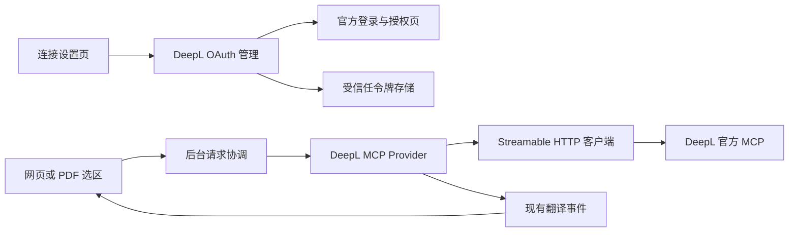

# 近译免 API Key 翻译：Cookie 复用可行性、小测试与候选设计

后续补充：用户指出 AtCoder Better / Codeforces Better 可免登录使用 DeepL。源码已确认它们采用匿名网页 JSON-RPC，既不复用 Cookie，也不走 OAuth；本机单次普通 MV3 探测返回 429。详见[OJBetter 免登录实现分析](OJBETTER_NO_LOGIN_DEEPL_2026-10-21.md)。下文对官方 REST 与 OAuth 的结论不应被解读为“所有 DeepL 路线都必须登录”。

日期：2026-10-21（Asia/Singapore）。产品基线：近译 0.7.0。用户明确约束：**近译不提供收费服务，希望没有 API Key 的用户也能使用大模型或 DeepL 翻译。** 本文不设计近译会员、付费墙或自动购买上游服务。

**结论：浏览器层面的登录态复用可行，隔离测试 16/16 通过；但“检测到 DeepSeek/DeepL Cookie，就能稳定自动翻译整页”没有通过真实服务验证，不能直接立项为已验证方案。DeepL 官方已有 OAuth 登录的免 Key MCP 接口，其公开授权发现测试通过，建议优先验证这一正式授权路线。**

这保留了用户期望的体验：已经登录过服务时，授权流程可能减少重新输入账号的步骤；近译取得的是官方授予的访问权限，不需要收集网页登录 Cookie。仍需用户首次连接和同意授权，不能承诺首次使用完全静默。

**1. 可行性分层，避免把三个问题混为一谈**

| 问题 | 本轮结论 | 证据等级 |
| --- | --- | --- |
| 扩展能否让浏览器携带已存在的登录 Cookie？ | 可以；相同 profile、正确域名权限及请求条件下已实测 | 隔离 Edge + 本机测试站点验证 |
| 扩展能否读取 HttpOnly Cookie？ | 有 `cookies` 与相应 host 权限时可以；普通 `document.cookie` 不能读 | 本机人工 Cookie 实测；不代表应当读取真实账号 Cookie |
| Cookie 能否替代 DeepSeek/DeepL REST API 的 Key？ | 官方文档没有这种认证方式；本轮匿名请求也被拒绝 | 官方认证规则 + 无凭证真实响应；未测试真实 Cookie 替代 Key |
| 能否调用两家网页内部接口自动翻译？ | 未完成真实端到端验证；没有已核验的公开集成契约，还存在明确服务规则约束 | 不将此路线标为可交付 |
| DeepL 是否存在官方无 Key 接入？ | 有，OAuth 2.1 + Remote MCP，包含 Free 账号；公开发现端点已验证 | 官方文档 + 未登录握手/元数据测试 |
| DeepL MCP 能否直接用于近译整页翻译？ | 有可行候选设计；扩展回调、真实授权、工具调用、免费额度适配仍待实测 | **尚未通过真实翻译验收** |
| 浏览器内置翻译能否作为无账号备用？ | 官方有 Translator API；本机隔离 Edge 暴露 API，但 en→zh 返回 `unavailable` | 本机不可用，未执行翻译，不作为已通过后备方案 |

**2. 为什么“曾登录过”不等于“扩展已经能翻译”**

Cookie 只证明某个站点保存过状态，不保证当前仍有效，也不保证它是完成翻译所需的全部凭证。真实站点可能同时使用 Cookie、网页存储中的访问令牌、CSRF 参数或其他会话状态；本次没有读取两家网站的真实令牌，因此不推测具体字段或私有协议。

浏览器自动携带 Cookie 与扩展读取 Cookie 值是两个机制。后台在拥有对应 host 权限时可以跨域请求；使用 `credentials: 'include'` 可在浏览器规则允许时携带凭证，不一定需要 `cookies` 权限。读取或修改 Cookie 值则需要 `cookies` 与对应域名权限。内容脚本跨域仍受其所在网页的同源限制。[Chrome 网络请求](https://developer.chrome.com/docs/extensions/develop/concepts/network-requests)、[Cookies API](https://developer.chrome.com/docs/extensions/reference/api/cookies)

还必须限定在同一浏览器、profile 与 Cookie store；无痕、其他浏览器或隔离测试 profile 不会自动共享登录。HttpOnly 不妨碍浏览器随请求发送，SameSite/分区/第三方 Cookie 设置仍会影响结果。网站 localStorage 也不是扩展后台的存储；service worker 没有 localStorage。[存储与 Cookie 规则](https://developer.chrome.com/docs/extensions/develop/concepts/storage-and-cookies)

因此，**即使读取 Cookie 的测试成功，也不能跳过服务认证、协议、额度和结果完整性的验证。** 本次测试特意包含“Cookie 已发送但另一个认证条件未满足，服务器仍拒绝”的反例。

**3. 按服务判断**

**DeepSeek：目前不能把网页会话作为主接入方式。**

官方开放平台使用统一账号，但明确要求 API Key 作为 API 调用凭证。统一账号不等于网页会话可替代 API 授权。本轮公开 `/models` 请求不带 Key 返回 HTTP 401。[API 认证](https://api-docs.deepseek.com/api/deepseek-api/)、[开放平台协议第 2 节](https://cdn.deepseek.com/policies/zh-CN/deepseek-open-platform-terms-of-service.html)

本次没有找到面向第三方扩展、委托使用网页额度的公开官方授权接口；这表示“未找到支持”，不表示绝对不存在。用户协议第 3.5 节对自动抓取、反向工程及不合理负载有约束，因此私有接口或网页自动化路线需要官方支持与明确的使用条件，不能以“近译免费”推导为可以长期批量调用。[DeepSeek 用户协议](https://cdn.deepseek.com/policies/zh-CN/deepseek-terms-of-use.html)

结论：保留当前 API / 用户自建本地服务支持；DeepSeek Cookie 方案暂列研究项。本轮没有调用其私有聊天接口、读取用户会话或进行反自动化绕过，也没有证据承诺其免费整页翻译稳定性。

**DeepL：区分 REST Key、网页 Cookie 和 OAuth MCP。**

REST API 仍使用 `DeepL-Auth-Key`，普通 Translator 账户或 Pro 网页订阅不能据此替代 API 凭证。匿名 `/v2/usage` 本轮返回 HTTP 403。[REST Quickstart](https://developers.deepl.com/docs/getting-started/quickstart)、[计划区别](https://support.deepl.com/hc/en-us/articles/360019924499-About-DeepL-plans)

免费网页服务条款明确限制未经书面许可使用内部 API。因此不采用提取 Cookie 后调用网页私有接口作为正式主方案。这是接入契约方面的约束，不据此对用户的想法作法律定性。[DeepL 免费服务条款](https://www.deepl.com/en/terms-of-use)

更合适的官方候选是 `https://mcp.deepl.com/v1/mcp`：采用 Streamable HTTP 和 OAuth 2.1，用户通过 DeepL 账号登录，无需手填 API Key；官方列出 Free 及席位制账号。使用量受账户权益和公平使用规则限制。近译作为通用浏览器扩展的具体用法、实际可用额度和授权回调兼容仍需验证。[Remote MCP 文档](https://developers.deepl.com/docs/mcp)、[官方产品与公平使用说明](https://www.deepl.com/en/ai-agents)、[连接器帮助](https://support.deepl.com/hc/en-us/articles/28876387688604-About-DeepL-AI-connectors)

另一个易过时的信息：新用户当前的 REST 免费入口是 API Developer，总计 100 万字符、用尽不重置；旧 API Free 已停止新购，存量账户的 50 万字符/月不能当成新用户承诺。这仍需要 Key，故不是本次首选免 Key 路线。[现行 API 计划](https://support.deepl.com/hc/en-us/articles/360021200939-DeepL-API-plans)

**4. 已执行的小测试与结果**

测试 A 使用新建 Edge profile、独立 MV3 测试扩展和本机 HTTP 服务。登录 Cookie 由测试服务临时生成；原生 fetch 未被替换。测试只回传布尔值、状态码和 Cookie 属性，不输出 Cookie 值。结束后关闭测试浏览器并删除临时 profile。没有连接用户的真实浏览器配置。

运行环境：Edge 155.0.4283.62，Windows；正式扩展的 manifest 源文件保持不变。

| 浏览器机制检查 | 结果 |
| --- | --- |
| 原生 fetch；未登录时服务拒绝 | 通过 |
| HttpOnly Cookie 对网页 `document.cookie` 不可见 | 通过 |
| 没有 `cookies` 权限时，Cookie 读取 API 不可用 | 通过 |
| `credentials: omit` 不发送测试登录态 | 通过，401 |
| 不读取 Cookie 值，仅用 `include` 自动携带登录态 | 通过，200 |
| 有 `cookies` 和 host 权限时可取得 HttpOnly Cookie 属性 | 通过 |
| 只有 `cookies`、没有目标 host 权限时无法取得该 Cookie | 通过 |
| Cookie 已携带，但测试端要求独立 Bearer 条件 | 正确拒绝，401 |
| Cookie 已携带但缺测试 CSRF；补充测试参数后 | 分别 403 / 200 |
| service worker 无 localStorage；原生请求可取消 | 通过 |
| 第二个隔离 profile 不继承第一个 profile 的会话 | 通过，401 |
| 退出登录后后续请求不再携带有效会话 | 通过，401 |
| 正式 manifest 源文件未改动 | 通过 |

共 **16/16 检查通过**。Bearer/CSRF 端点是人为构造的反例，不是对 DeepSeek 或 DeepL 私有协议的模拟；返回 200 也不是完成了一次真实翻译。

浏览器内置 Translator API 另作观察：存在接口，en→zh 可用性为 `unavailable`。没有下载模型、没有执行翻译；不计入 16 项机制通过结果。

测试 B 直接访问公开官方端点，不带 Key、Cookie 或用户文本，不注册 OAuth 客户端，也不执行翻译：

| 公开探测 | 实际结果 | 能证明什么 |
| --- | --- | --- |
| DeepSeek `/models` 无鉴权 | 401 | 官方 API 拒绝本次无凭证请求 |
| DeepL REST `/v2/usage` 无鉴权 | 403 | 该 REST 端点拒绝本次无凭证请求 |
| DeepL MCP 匿名 `initialize` | 401，带 `WWW-Authenticate` 资源元数据地址 | 需要 OAuth Bearer 授权，服务提供标准发现入口 |
| Protected Resource Metadata | 200 | 返回 MCP 资源与授权服务器地址 |
| Authorization Server Metadata | 200 | 声明授权码、刷新令牌、PKCE S256、public client `none`、注册及撤销端点 |

匿名 MCP 初始化在认证前被拒绝，因此**没有完成 MCP 协议版本协商、工具发现或翻译工具调用**。元数据声明支持某能力，不等于本次已执行并验证该能力。

复现命令：

```powershell
node scripts/probe-session-translation.mjs
node scripts/probe-public-translation-auth.mjs
```

测试脚本：[浏览器机制探测](../../scripts/diagnostics/probe-session-translation.mjs)、[公开认证探测](../../scripts/diagnostics/probe-public-translation-auth.mjs)。结果：[16 项浏览器证据](../evidence/session-translation-browser-probe-2026-10-21.json)、[公开端点证据](../evidence/public-translation-auth-probe-2026-10-21.json)。第二条命令访问公开服务；它仍然不使用账号，也不产生翻译结果。

**5. 设计选择与当前决策**

| 方案 | 选择 |
| --- | --- |
| 自动扫描并复制 DeepSeek/DeepL Cookie，调用网页内部接口 | 不进入正式主线；没有真实业务通过证据，也缺稳定公开契约 |
| 用户点击“连接 DeepL”，经官方 OAuth 后调用 MCP | **优先候选**；公开发现已通过，接下来需要真实授权与小文本翻译验收 |
| 浏览器内置 Translator | 保留为可选后备；需逐设备能力探测，本机本轮不可用 |
| 用户已有 Key / Ollama / 自建服务 | 保留现有能力，不要求免 Key 用户配置这些内容 |
| 近译自有收费会员、公共 Key、自动代付上游请求 | 不在本需求范围；近译保持免费，不静默切换到计费服务 |

下面给出的是 **DeepL OAuth MCP 候选设计**。它足够具体，可以据此开展下一阶段 POC；由于真实账户授权、回调和翻译尚未通过，不应写成已经能上线的功能设计或已承诺功能。

**6. 候选用户流程**

1. 设置页提供“连接 DeepL（无需 API Key）”。默认展示连接状态和上游额度说明；高级设置继续保留现有 API 模式。
2. 用户主动点击后申请最小必要权限，打开 DeepL 官方授权页。已有登录态由 DeepL/浏览器自然处理，近译不读取密码或网页登录 Cookie。
3. 用户在官方界面确认授权；返回扩展后验证回调，再换取面向 MCP 的访问令牌。
4. 进行能力探测与一句公开样本文本的真实翻译，成功后才显示“已连接并验证”。仅完成 OAuth 不等于翻译已经验证。
5. 用户点击“翻译当前页面”后，复用现有段落提取与呈现；按上游能力分批提交。
6. 额度不足或需要重新授权时暂停，保留已完成译文，提供重新连接或用户主动选其他服务的入口；不自动开通付费计划。
7. 用户可“断开连接”。本地清除令牌并尝试官方撤销；网络不可用时明确说明远端撤销未确认。断开近译不等于替用户退出 DeepL 网站。

**7. 模块、数据流与责任边界**



| 所有者 | 职责与边界 |
| --- | --- |
| 后台组合根 | 选择现有 API provider 或新 MCP provider，统一请求 ID、取消、超时与配置变更失效 |
| OAuth 管理模块 | 授权发现、客户端身份、PKCE/state、授权码交换、单次合并刷新与撤销；不给内容脚本返回 token |
| MCP transport | 初始化/版本协商、会话头、JSON/SSE 解析、工具发现与调用；不读取网页 DOM、不管理 UI |
| DeepL provider | 仅调用核验后的翻译工具，解析成现有 text/segment 结果；不开放任意工具名和任意 URL |
| 设置存储 | 持有模式、连接修订号与受信任令牌；公开投影仅含状态和能力 |
| 页面会话 | 段落队列、内存复用和 DOM 生命周期；通过明确的 provider 能力控制并发和批量 |

继续复用 [TranslationProvider](../../src/shared/contracts.ts#L38) 和后台已有的请求/取消所有权。当前 [后台 Key 检查](../../src/entrypoints/background.ts#L120)、[API provider 的 credentials: omit](../../src/providers/openai-compatible.ts#L175)、[页面 Key 检查](../../src/page/mount.tsx#L75)说明这不是把一个 fetch 改成 `include` 就能完成的功能。

保留现有 OpenAI 兼容适配器的 `credentials: omit`；OAuth 是独立认证方式，不应让任意自定义 API 自动携带浏览器 Cookie。仅新增所需模块，不在生产代码里引入通用网页自动化或私有协议模拟框架。

**8. OAuth 设计细节与必须补测的条件**

- **发现链路：** 从固定官方 MCP 端点的认证挑战读取资源元数据，再读取授权服务器元数据。校验 HTTPS、资源与 issuer 对应关系、允许的域名，不能跟随网页提供的任意 URL。
- **客户端身份：** 本轮元数据声明支持 client ID metadata document 与动态注册。优先按协商规范选择客户端身份方式；使用动态注册时生成 public client，不把客户端 secret 当成扩展里可保密的内容。静态客户端元数据可独立托管，不等于需要翻译中转服务器。
- **回调：** 使用 `browser.identity.getRedirectURL()` 获得真实回调，再通过 `launchWebAuthFlow` 完成授权。Chrome/Edge 商店扩展 ID 与开发安装 ID 不同，应各自验证回调注册和接受情况；本轮没有验证 DeepL 接受哪种扩展回调。
- **PKCE 与 state：** 每次生成新的 verifier、S256 challenge 和随机 state；验证完整回调地址、state、错误字段与一次性消费。授权和令牌请求绑定正确 MCP resource，不将令牌发给 REST API 或任意主机。
- **令牌保存：** access token 优先放仅受信任扩展上下文可读的会话存储；刷新需要的 token 若为保持连接而落盘，限制在受信任本地存储，不同步、不回显、不导出、不进日志。浏览器存储不是密码保险库，不能声称对本机高权限进程保密。
- **刷新：** 多个段落同时遇到过期只触发一次刷新；连接修订号防止退出/换账号后旧刷新结果重新写入。元数据支持 refresh_token 不保证本次授权一定签发刷新令牌；持久连接所需 scope 应按发现信息和用户授权选择，没有刷新令牌时回到重新授权。按服务返回处理轮换，不假定刷新 token 永不变。
- **权限：** 预计新增 `identity` 与精确的官方网络域名访问；不为 OAuth 主方案新增 `cookies` 或全站 Cookie 读取能力。最终权限以实际授权链与请求目标核验为准。

以上是基于当前官方能力与 MCP/浏览器标准提出的设计，非现成实现。[DeepL MCP](https://developers.deepl.com/docs/mcp)、[Chrome identity](https://developer.chrome.com/docs/extensions/reference/api/identity)、[MCP 授权规范](https://modelcontextprotocol.io/specification/2026-07-28/basic/authorization)

**9. 翻译协议、批处理与能力降级**

OAuth 完成后依次执行 MCP 初始化、初始化通知和工具发现。官方记录的文本工具是 `translate-text`；实际参数与结果结构以授权后的 `tools/list` schema 核验，不直接套用 REST `/translate` 请求，也不假设 MCP 是 Chat Completions。[官方工具说明](https://developers.deepl.com/docs/mcp)

建议首版只开放纯文本翻译和语言查询。扩展自行调用固定翻译工具即可，不必再引入一个大模型决定调用哪个工具；不开放创建/删除术语库、任意文档上传等不相关操作。

官方当前文档将每请求 context、formality、custom instructions 及术语/样式能力与账号权益区分，Free 不支持这些增强参数。适配器必须按发现的能力过滤参数；当前“附带上下文”设置在不支持时明确显示不可用，不擅自拼入待译文来冒充同等能力。[账户能力表](https://developers.deepl.com/docs/mcp)

候选调度采用全扩展共享的小并发队列，初始并发 1，验证后最多小幅提高；划词优先于整页。沿用已有去重和部分成功保存。官方当前文档列 Free 文本翻译每请求 5,000 字符、最多 50 个文本，设计先按保守总字符数分批，并根据实际 schema/账户限制调整；这些限制不是“每日无限用量”的承诺。[请求限制](https://developers.deepl.com/docs/mcp)

已有 32 并发不能直接移植到账号免费权益。429 按服务信息有限退避，额度耗尽则暂停，不多账号轮换，不循环重试以绕过额度。显示当前页面已完成量；未知剩余额度就显示未知，不伪造计数。

“不自动付费或切换计费服务”是近译拟实现的行为，不能代替上游账户自己的计费约定；接入时仍需识别账号权益。本报告不替用户订阅或升级任何服务。

每批请求在扩展内维护稳定段落 ID 与顺序。结果数量、目标语言及文本类型均需校验；不完整时保留确认成功项，只重试缺失项。当前页面的复用键至少包含服务、账号连接修订、语言和输入；断开账号、换服务或换语言使旧请求失效。

MCP 传输支持 SSE 不等于译文逐 token 流式输出。应在整段结果确认后发 `segment` 或最终 `result`，不能伪造实时流。DeepL 普通翻译也不提供近译目前的 LLM 词典 JSON 或句法结构：无该能力时返回普通译文并隐藏增强区，不编造分析结果。

建议增加独立的 provider 能力信息，例如是否可纯翻译、可词典、可句法、批量上限及并发建议；兼容原 API provider 的行为。公开 UI 状态改为连接是否可用，而不是一律以 `hasApiKey` 判断。

**10. 状态、失败与生命周期**

主状态：`未连接 → 授权中 → 检测能力 → 验证翻译 → 可用 → 翻译中 → 可用`。另有需要重新授权、额度受限、暂不可用和服务不兼容状态。

| 事件 | 处理要求 |
| --- | --- |
| 用户取消授权 | 回到未连接，不自动再次弹出登录窗口 |
| 401 / token 过期 | 合并刷新一次；失败则暂停并要求重新连接 |
| 403 | 区分权益、组织策略和授权问题；不一律解释为“余额不足” |
| 429 | 有限退避或暂停，保留成功结果 |
| 网页关闭、换选区、恢复原文、切换服务 | 使用现有 AbortController 与 requestId 失效规则，停止本地排队并丢弃迟到结果 |
| worker 重启 | 重新构建内存状态并检测令牌；不自动重放未知完成状态的翻译，以免重复用量 |
| 工具 schema 或结果改变 | 连接标为不兼容，禁用本次功能并保留其他 provider，不盲目解析 |
| 用户断开 | 先失效连接修订号并取消任务，再清本地 token、尝试远端撤销；迟到刷新不得恢复连接 |

登录和用户授权等待不占用现有翻译的 90 秒超时。取消浏览器请求不保证上游已经停止或不计用量；界面应准确表述为停止当前翻译任务，不承诺上游费用/额度回退。

**11. 哪些验收通过后才可以实现或发布**

当前通过：浏览器机制、真实公开认证响应、OAuth 元数据发现。以下业务门槛尚未完成：

1. 用近译测试扩展的真实回调完成官方 OAuth；验证新登录和已有登录两条路径，并确认取消授权行为。
2. 免费账号完成一句公开英文的真实翻译；之后验证 2–3 段及一页短文的映射与完整性，记录实际耗时和可见额度反馈。
3. 核验 `tools/list`、文本工具输入/输出、免费限制与近译的通用扩展用途适配；不能用其他客户端成功替代这个验证。
4. 验证 401 刷新、退出撤销、重新授权、worker 重启、页面关闭、取消和迟到结果；错误报告不含 token。
5. 验证 Chrome 与 Edge，拒绝权限与限额状态均能恢复；不会退回到收费 API 或其他服务而不告知用户。

这些步骤需要真实账户的官方同意授权；本轮没有代替用户同意、注册客户端或执行真实 DeepL 翻译。因此最终状态是 **“浏览器机制与 OAuth 发现已通过；免 Key 实际翻译仍待授权 POC”**，不是“Cookie 功能已通过全部小测试”。

**12. 交付范围与架构影响**

本轮交付 Markdown、两个可复现探测脚本与两份脱敏测试结果；没有修改生产扩展代码、权限或用户设置。未来 OAuth provider 属 R2 架构变更：新增认证方式、能力声明和令牌生命周期，需要保持原 API 请求契约与取消行为兼容。

近译免费这一产品要求保持不变。优先研究的实现方向是 **“用户主动连接自己的 DeepL 账号，通过官方 OAuth 获得受限授权，再完成页面翻译”**。不要求用户管理 API Key，也不承诺上游账号拥有无限额度。
