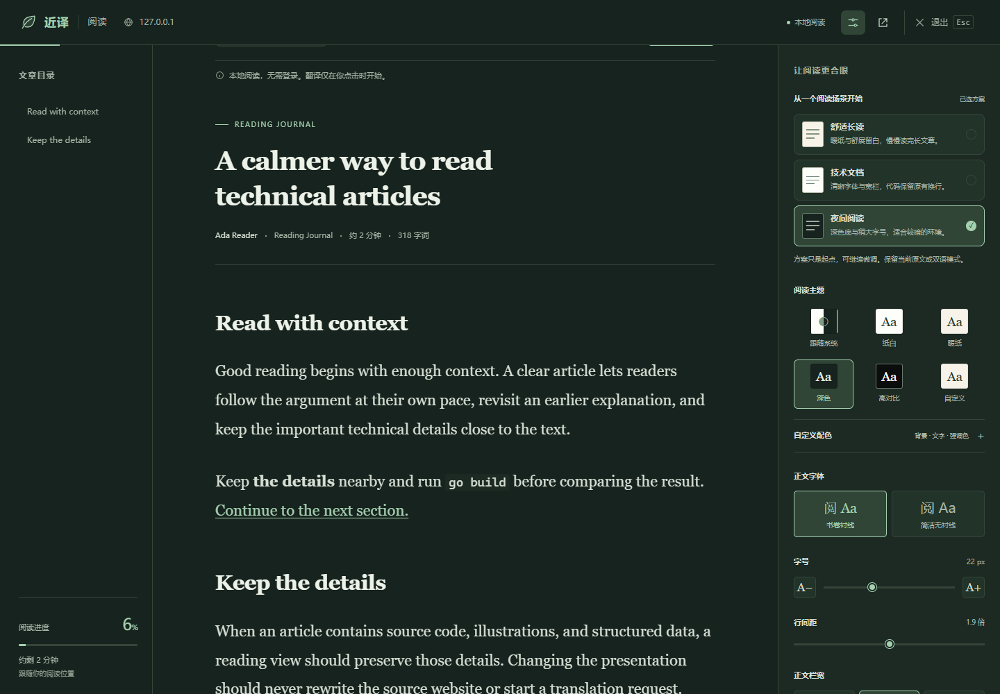
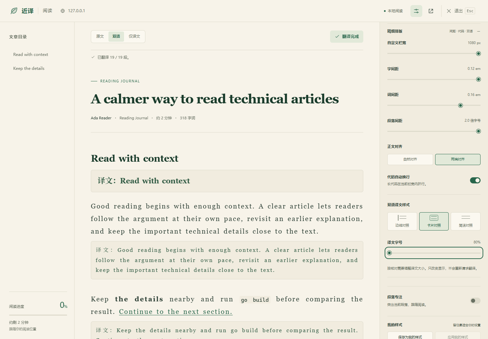

# 0.10.0 阅读自定义交付与验证

日期：2026-10-23（Asia/Singapore）。本轮在现有本地阅读、双语会话和 DeepSeek 词义预览上迭代，保留工作区原有未提交内容。

## 从调研到产品取舍

先依据 Firefox、Edge、Safari、Readwise、Clearly 和简悦的官方资料比较，再由子代理在隔离浏览器走查首次入口。Clearly 与 Readwise Web App 在未登录时到达账号入口，Readwise 官方共享文章可直接读，但不展示完整外观控件；没有把这些入口观察冒充安装后的全面竞品体验。详细证据与链接见[官方能力比较](READING_CUSTOMIZATION_COMPETITIVE_ANALYSIS_2026-10-23.md)和[首次走查](READING_FIRST_USE_COMPETITORS_2026-10-23.md)。

值得借鉴的是成熟的字体/间距/主题与可收起工具。近译的重点是把排版、个人偏好和双语对照连成一个可恢复的流程；没有证据宣称所有能力全面超过六款竞品，也没有把字号或配色声称为独有创新。

| 用户任务 | 0.9.0 的限制 | 0.10.0 已交付 |
| --- | --- | --- |
| 第一次调到舒服 | 逐项试七个基础偏好 | 舒适长读、技术文档、夜间阅读，一次应用；真实正文即时预览 |
| 按自己习惯精调 | 字号 16–28、行高 1.5–2.2、三栏宽 | 字号 14–36、行高 1.4–2.4、自定义栏宽 480–1080、字距/词距/段距、对齐与代码折行 |
| 跟随环境或自行配色 | 纸白、暖纸、深色 | 六主题，新增跟随系统、高对比、自定义三色；对比度提示与一键修复 |
| 双语核对 | 固定边线与字号 | 边线/卡片/简洁对照，译文字号 80%–120%，显示切换复用已有译文 |
| 放心尝试后恢复 | 没有个人快照或撤销 | 保存/应用“我的样式”、恢复默认、撤销上次调整；不改变原文/双语/译文模式 |
| 换设备或备份 | 无版式文件 | 内容无关 JSON 导入/导出，损坏或不兼容文件不覆盖当前设置 |
| 在中段调字号 | 没有显式读点保障 | 源段落与段内比例保持，普通动效下也瞬时校正，目录主动跳转优先 |
| 确认下次会记住 | 保存错误被静默忽略 | 保存中/成功/失败反馈及重试；关闭时提交最后待保存快照 |
| 小屏或放大阅读 | 断点切换可能残留 inert | 390px 与真实 200% 缩放可操作；抽屉正确对齐顶栏，窄→宽解除锁定 |

固定一个“我的样式”，本轮没有扩展成多方案管理、账号同步、网络字体或云端内容服务。设置内的高级项折叠展示，普通阅读无需理解所有数值。

## 实际运行的验证

| 检查 | 结果 |
| --- | --- |
| TypeScript 严格检查 | 通过 |
| 模块依赖边界 | 通过 |
| 单元测试 | 51 个文件、1,214 项通过 |
| Edge 155.0.4283.62 | 17 项完整阅读场景通过 |
| Chrome for Testing 156.0.8078.4 | 17 项阅读 + 27 项划词/PDF，共 44 项通过 |
| Chrome / Edge 生产构建 | 通过，版本均为 0.10.0 |

浏览器测试使用独立配置、固定公开测试正文和模拟模型 SSE，不使用真实 Key。外观调整、应用个人样式、版式导入导出及恢复不新增翻译请求；已有翻译缓存、词义提前显示、取消、纯文本渲染和 PDF 功能通过相应回归。

新增验证包括：旧数据补默认；字段/颜色/范围白名单；预设不切模式；个人样式不递归；对比度含派生面板/选中/悬停背景；文件超限、非法与异步过期；保存失败重试/旧回执隔离/卸载提交；普通动效位置保持；移动目录跳转；真实浏览器缩放至 200% 后全套控件可达。

首轮发现并修正了两处真实交互缺陷：移动抽屉顶部重复偏移、锚点校正受 smooth 影响。独立复核另修正了移动目录关闭抽屉后回到旧段落的问题。测试本身也修正了标题译文继承标题字号的断言，以及 Edge 原生下载面板被当作测试网页关闭导致阻塞的问题；最终完整套件无失败、无重试。

## 重装与使用

安装采用原目录备份后更新，保留扩展 ID 和浏览器存储，333 个产物文件的 SHA-256 与最终 Edge 构建一致。[安装与备份证据](../evidence/reading-customization-install-2026-10-23.json)。现场只读核验的结果另见[实际安装检查](../evidence/reading-customization-installed-check-2026-10-23.json)。

真实 Edge 运行 0.10.0，23/23 项现场检查通过：三个场景、六主题、全部高级控件、个人样式与导入导出可达，固定本机样例的 20 段和代码保留，字号控件/偏好/实际渲染均为 20px。检查前后阅读偏好一致，没有写设置或触发翻译；临时标签、文件与核验进程均已清理。[总体验证数字](../evidence/reading-customization-validation-2026-10-23.json)。

刷新原网页，按 **Alt+Shift+R** 进入阅读；在“显示设置”中选一个场景，再调整常用项或展开“精细排版”。满意后保存为“我的样式”，也可导出版式备份。退出时保留当前已保存偏好；改变显示不会重新请求模型翻译。

## 架构影响与边界

风险 R2：兼容扩展阅读偏好和展示/布局生命周期。shared 拥有纯规则及文件格式，ReadingSettings 拥有本地文件交互，ReadingView 拥有面板，mount 拥有保存、撤销和锚点；platform 仍独占持久化。没有新增第三方依赖、权限或生产网络服务。保存回执与导入均有失效隔离，DOM、监听器、定时器、对象 URL 和快照保持有界并按生命周期释放。

本轮验证固定文章、浏览器及确定性任务，不代表所有网页都能完美提取，也没有多人可用性研究支撑“全面超越竞品”。重排期间的读点用段落内比例近似；单个极长段落大幅改变形状时不保证精确到同一字符。页面真正卸载时保存依赖浏览器尽力投递，不能承诺崩溃/强制终止时写入成功。
