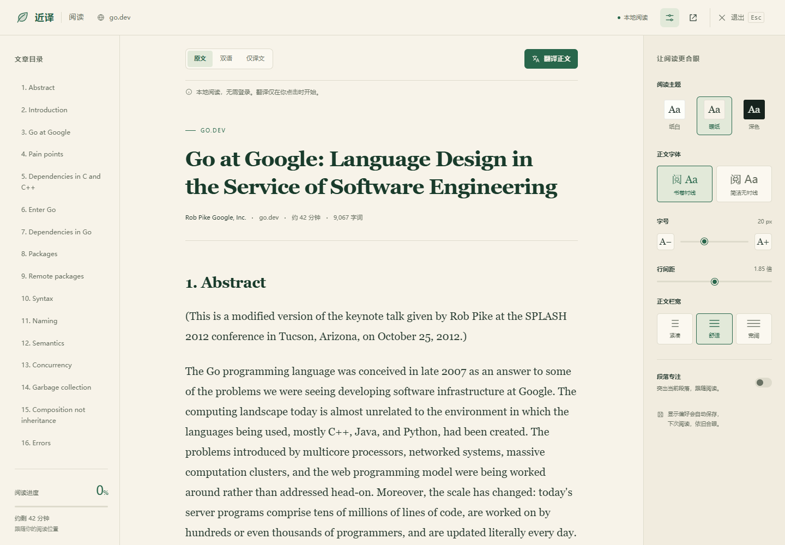

# 近译 0.8.0 阅读模式：设计、使用与验收记录

日期：2026-10-22。实现依据为本轮当前源码；产品取舍沿用[阅读模式竞品研究](READING_MODE_COMPETITIVE_ANALYSIS_2026-10-22.md)。本文记录本地正文阅读、双语衔接与生命周期边界，不把网页阅读模式等同于 PDF 阅读器。

**0.8.0 已实现独立的网页阅读界面，并复用既有翻译服务、取消机制和文档内译文缓存。** 完整验收、实际 Edge 安装与性能数字见第 8 节；竞品分析与可验证的体验目标分开记录，不把功能实现等同于已全面优于竞品。

## 1. 如何使用

在普通 HTTP/HTTPS 文章详情页打开阅读模式，可使用三个入口：

1. 点击网页侧边工具栏的“阅读模式”。
2. 点击近译扩展图标，在 Popup 选择“阅读当前网页”。
3. 在已经加载近译内容脚本的网页按 `Alt+Shift+R`。

Popup 在当前页尚无内容脚本时，使用既有 `activeTab` 授权向当前标签页注入脚本，再发送打开命令。此路径可先本地阅读，不要求登录、API Key 或翻译服务就绪。浏览器内部页、扩展页和 PDF 不属于网页阅读入口；PDF 继续使用 Popup 的 PDF 阅读器入口。扩展更新后，已打开的网页需要刷新以使用新脚本。

打开后可以：

- 用文章目录跳转章节，观察当前章节和阅读进度；没有标题时显示说明，不生成虚构目录。
- 在“原文”“双语”“仅译文”间切换。切换只控制展示，不自动请求翻译；尚无译文时仍显示原文，避免正文消失。
- 点击“翻译正文”才启动缺失内容的翻译；进行中可停止，停止后保留已完成部分，失败段落可显式重试。
- 在显示设置选择纸白、暖纸、深色主题，衬线/无衬线字体，16–28 px 字号，1.5–2.2 倍行距和紧凑/舒适/宽阔栏宽；段落专注突出当前阅读块。
- 通过工具栏或段落的“回到原文位置”返回原网页对应位置；点击退出或按 `Esc` 关闭阅读界面。窄屏抽屉打开时，`Esc` 先关闭抽屉并恢复触发按钮焦点，再次退出阅读。

原网页已有成功译文时，从页面工具栏进入阅读会先停止原页在途翻译，复制成功结果供阅读层本地预览。同一文档内关闭后再次打开，也可复用已有结果；显示切换和缓存命中不会重复发送正文。

## 2. 正文提取与安全呈现

`src/reading/extract.ts` 使用 `@mozilla/readability` 0.6.0。提取器先读取当前已经加载且可见的页面内容，构造独立、惰性的 HTML 文档快照，保留受限元信息和源节点标识，再将该副本交给 Readability。原网页 DOM 不交给解析器修改。

Readability 使用 `serializer: node => node` 返回 DOM 节点，关闭 JSON-LD 解析。实现不把其 HTML 字符串写入 `innerHTML`，也不使用 `dangerouslySetInnerHTML`：最终渲染通过严格标签、属性与 URL 白名单逐个创建 DOM 元素和文本节点。Readability 提取失败或遗漏显式文章中的代码块/表格时，可回退到合格的 article/main 语义区域；不会把整个 body 无条件包装成成功的文章。

标题优先使用语义正文中唯一的 H1，避免浏览器标题中的站点后缀占据首屏；仅移除正文开头重复标题和精确匹配的短署名。章节内部纯装饰的同页定位符（例如 ¶）会清理；有明确“目录 / Contents / Table of Contents”标签且全部内容为同页章节链接的导航表或相邻列表会移除，避免与阅读目录重复。普通数据表、外部链接列表以及文章后文同名标题保留。这些规则基于结构和文本，不包含 Go 域名适配分支。

| 内容 | 处理方式 |
| --- | --- |
| 正文、列表、引用、代码、表格、图注、普通图片 | 保留允许的结构与文字，交由阅读样式排版；宽代码和表格在自身区域横向滚动 |
| 原站脚本、事件处理器、内联样式、任意 class/id | 不进入最终呈现；阅读器生成自己的样式与唯一章节锚点 |
| iframe、表单、输入控件、插件对象、SVG、音视频等 | 从阅读快照排除；阅读模式不承担原站交互或播放器功能 |
| 链接 | 只接受无账户凭据的 HTTP/HTTPS URL，解析相对地址；外链添加 `noopener noreferrer`，可映射的文内锚点改为阅读层定位 |
| 图片 | 提取时仅保存校验后的 HTTP/HTTPS 地址，展示阶段再设置 `src`；使用 lazy/async 及 `no-referrer`，不执行图片上的原站行为 |
| MathML | 提取可用的 TeX 注释或文字，作为文本呈现；本轮没有新增完整公式渲染引擎 |

工作量上限按页面复杂度约束：80,000 个遍历节点、40,000 个元素、深度 160、累计 4,000,000 个文本单元。超过限制或没有合格文章时，显示失败说明及返回/重新提取入口，不把被截断的正文标成完整文章。提取只覆盖当前已加载内容，不保证未加载全文、复杂动态应用或所有网站都可识别。

## 3. 界面、定位与长文工作量

阅读层由独立 `near-reading-mode` host、Shadow DOM 和原生 `HTMLDialogElement.showModal()` 构成。Shadow 隔离网站样式，原生模态 dialog 将界面置于浏览器 top layer，并约束焦点。React 管理工具栏、目录与设置等界面；提取器生成的安全文章 DOM 由阅读控制器持有并挂载。

文章快照携带 `sourceMap`，将阅读块的内部标识映射到原网页元素。打开时记录原滚动坐标和焦点，并尽量从原网页正在阅读的段落进入；普通关闭恢复进入前滚动与仍有效的焦点。“回到原文位置”在关闭后定位对应原节点；节点已被网站删除时，不尝试操作失效引用。当前文档内重开可按上次阅读块或进度比例恢复；该位置只在内存中保留。

挂载文章时建立源块与标题元素索引。滚动、窗口变化及译文导致的布局变化合并到最多一个待执行的 `requestAnimationFrame`；进度按阅读容器的实际可滚动距离计算并限定在 0–100%，不与翻译完成率混用。短文直接视为已至文末。测量仍需读取索引中相关元素的几何位置，本记录不将其描述为恒定时间算法，也没有未经实测的长文延迟承诺。

窄屏将目录与显示设置变为可访问抽屉；背景正文在抽屉打开时设为 inert，面板提供明确名称、展开状态和关闭入口。按钮具有可访问名称、模式使用 `aria-pressed`、进度使用 `progressbar`，状态通过温和的 live region 告知。用户选择 reduced motion 时禁用平滑滚动和相关过渡。

## 4. 共享划词界面与原生 dialog 的组合

原生模态 dialog 会使外部页面区域处于不可交互状态，因此已有划词浮层不能继续留在 dialog 外面。本轮在入口组合根解决这个所有权问题：

```text
selection.content 组合根
  ├─ mountSelectionTranslator → 创建并持有同一个 selection host
  ├─ createReadingMode → 打开原生 dialog
  └─ onSelectionPortal(dialog / undefined)
       打开：将已有 selection host 移入 dialog
       关闭：将同一个 host 移回 document.documentElement
```

`selection/mount.tsx` 只通过 `onHost(host, close)` 交付宿主引用与关闭动作，不依赖阅读模块。阅读控制器只通知 portal 位置，不创建第二套划词翻译请求器。组合根在移动宿主前先关闭并取消划词翻译；关闭阅读时先移出共享划词 host，再关闭 dialog、卸载 React 并移除阅读 host，避免共享浮层被随阅读界面销毁。整个内容脚本失效时，按页面会话、阅读控制器、划词控制器的所有权释放各自资源。

这条闭环允许阅读内继续使用既有划词卡片，同时保持 selection 与 reading 之间没有反向模块依赖。关闭动作还清除尚未执行的选区捕获计时器与旧事件路径，防止进入阅读后旧选区按钮重新出现；两项生命周期单测与阅读内划词的真实 Edge E2E 已覆盖。

## 5. 翻译复用与会话有效性

`src/reading/translation.ts` 的 `ReadingTranslation` 持有阅读快照对应的 `PageTranslationSession`。它只修改阅读副本，不向原网站插入阅读层译文。原文与译文通过自己的 DOM 标记区分，模型或服务返回的结果仍以 `textContent` 显示。

本轮在既有 session 内增加三个通用接缝：

| 接缝 | 契约 |
| --- | --- |
| `translationSnapshot` | 返回新的 `ReadonlyMap<string, string>` 副本，不暴露内部可变 Map；只包含成功的纯文本缓存 |
| `seedTranslations(entries)` | 仅未销毁且处于 idle 时导入非空白字符串原文/译文；复用原来的 1,500 项和 2 MiB 文字字节预算及淘汰规则 |
| 可选 `isCurrent(segment)` | 默认仍使用普通网页 `segmentIsCurrent`；阅读层改用自有 root 包含关系、节点连接状态和每个原始 Text.data 的严格快照比对 |

整段缓存与网络请求上限不同：超过 12,000 字符的整段成功结果可以在 2 MiB 总预算内导入并复用，不因单请求大小限制而再次翻译。缓存不持有跨视图 DOM 节点。阅读层显式启动前可本地预览种入结果；只有用户点击翻译，session 才为未命中内容排队。

章节因去除末尾单个 ¶、§ 或 # 定位符而发生纯展示变化时，阅读控制器校验源节点文本与清理后文本的严格对应关系，再为成功译文建立内存别名，避免重复请求该标题。不会宽松删除任意字符或修改真实的 C# 等标题；其他装饰清理未命中已有缓存时，仍按普通缺失段落处理。

自定义有效性检查的原因是阅读模式会主动隐藏已翻译原文，不能把自己的显示选择误当成原站正文失效。它没有放松普通网页校验，也不跳过阅读源文字的一致性验证。文档、代次与控制器生命周期继续由阅读所有者管理。

翻译继续走既有 `TranslationClient`、后台 provider 和按引擎选择的 `pageExecutionPolicy`；没有新增私有翻译服务或独立 DeepL 请求路径。DeepL 沿用同一个后台 provider 及共享调度/429 冷却保护，跨页面并发仍受原策略约束。阅读模式不声称解决此前 DeepL 全文耗时或 429 稳定性问题，具体限制继续见[第五轮性能记录](DEEPL_PERFORMANCE_V5_2026-10-22.md)。

## 6. 数据与资源生命周期

正文提取不调用翻译服务，不上传原文。图片展示可能请求原图片站点，点击外链也会导航；因此“本地阅读”描述正文提取和呈现的位置，不等于整个浏览器完全无网络活动。原有可选连接准备及翻译服务政策仍适用，见[隐私说明](../guides/PRIVACY.md)。

只有点击“翻译正文”、重试或主动划词翻译才按现有流程发送相应内容；切换原文/双语/仅译文、目录、主题和字号不会自动发送正文。仅译文模式只隐藏已成功翻译的原文，未完成或失败的段落保留原文以便继续阅读。

| 数据/资源 | 持有者与释放时点 |
| --- | --- |
| 安全文章 DOM、`sourceMap`、源块/标题索引、当前聚焦块 | 阅读控制器；关闭时释放引用并移除阅读 DOM |
| 阅读翻译 session、原始 Text 快照、译文 DOM 映射、在途请求 | `ReadingTranslation`；关闭时 dispose，取消活动任务，旧结果不得重新打开或回填到已销毁界面 |
| 当前文档内成功纯文本缓存 | 有界 session/阅读控制器；普通关闭可保留以重开复用，导航、连接或权限变化、销毁时清理 |
| 原页滚动/焦点、阅读块标识与进度 | 仅当前文档内存；普通关闭用于恢复，不写入浏览记录或跨页阅读历史 |
| scroll/resize 监听、待执行 RAF、导航检查计时器、打印样式、React root、dialog | 阅读控制器；关闭时取消/断开/卸载；文档失效时 dispose 移除长期监听和偏好计时器 |
| 阅读显示偏好 | `platform/reading-preferences`；独立 `reading-preferences:v1` 键保存，不混入 `settings:v1` 或模型凭证 |

持久化偏好只有 theme、fontSize、lineHeight、width、fontFamily、mode 和 focus。规范化会丢弃任意正文、HTML、URL、API Key 及其他字段；访问本地存储前应用既有 TRUSTED_CONTEXTS 限制。后台先验证同扩展 id，再仅允许自身受信任扩展页或带整数 tab id 的 HTTP(S) 顶层内容脚本请求读写。写操作串行，读取等待此前排队写入，失败不会毒化后续写入。偏好存储不读取或改写模型设置。

## 7. 架构影响与依赖

风险等级为 **R2**：新增阅读模块、UI 生命周期与可复用 session API，跨越了界面装配和数据所有权边界。

- 阅读提取、呈现、翻译副本与控制器职责归 `reading`；普通网页 DOM 继续由网站拥有，原页翻译继续由 `page` 拥有。
- 依赖方向为入口组合根 → reading/selection/page；reading → page/shared；page 继续通过既有无凭证 transport 连接后台。reading 不直接读取凭证、不导入具体 provider。
- 新增运行时依赖只有 `@mozilla/readability` 0.6.0；`jsdom` 30.1.3 和 `@types/jsdom` 30.0.0 是单元测试开发依赖，不进入生产正文提取路径。
- 未新增账户、远端中转、正文持久化、遥测或阅读专用翻译协议。原有 start/cancel/reset、provider、限流与凭证隔离契约保持；新增的缓存导入在 idle 外无效。
- `scripts/check-boundaries.mjs` 已声明 reading 可依赖 reading/page/shared；共享划词 host 的移动由入口组合根组织，不建立 reading ↔ selection 循环。

## 8. 最终验收与实际安装

2026-10-22 21:24（UTC+8）完成最终代码回归、实际 Edge 安装与三次新标签页复核。[安装与文件校验](../evidence/reading-mode-install-2026-10-22.json)、[三轮数字证据与截图摘要](../evidence/reading-mode-go-2026-10-22.json)。

| 检查 | 最终结果 |
| --- | --- |
| 完整单元测试 | **818 / 818 通过，33 个文件**；包括 26 项正文提取测试、偏好/缓存/翻译安全及两项待执行选区捕获的关闭/销毁竞态测试 |
| 完整 Edge 浏览器回归 | **68 / 68 通过**；包含 9 项新增阅读模式流程及原网页/PDF/服务配置流程 |
| 类型、模块依赖边界、差异格式 | 全部通过 |
| Chrome / Edge 生产构建 | 两者成功，版本 0.8.0 |
| 实际日常 Edge | 原扩展 ID 原位更新、重新加载；最终构建的 **313 个文件 SHA-256 与安装目录逐个一致**；没有新增权限或读取模型凭证 |
| 竞品同条件用户研究 | 未执行；不支持“全面优于竞品”的宣传结论 |

九项阅读 E2E 覆盖：中英文免 Key 本地阅读；三态显示与部分完成保护；关闭重开复用译文；从原页种入译文且清理定位符后不重复请求；显示偏好跨文档保存；快捷键/退出/迟到结果；目录/进度/段落回原页；模态阅读内划词卡片及退出取消；390 px 窄屏抽屉和代码/表格局部横向滚动。服务响应均模拟并拦截真实翻译网络，证明的是功能与调用边界，不是上游翻译质量或速度。

日常 Edge 155.0.4283.62、扩展 `dbdooijmbinjmnbmgglajigaoiinolnc`，实际加载目录为 `D:\浏览器翻译扩展\artifacts\installed\near-translate-edge-v0.1.0`。目录名沿用历史安装，不代表版本仍为 0.1.0；运行时与 manifest 均为 0.8.0。测试地址为用户之前提供的完整 [Go 文章](https://go.dev/talks/2012/splash.article?utm_source=chatgpt.com)。

| 三个新建前台 Go 标签页 | 安全正文挂载 | 下一 RAF 时点 | 保留内容 |
| --- | ---: | ---: | --- |
| 第 1 轮 | 106.7 ms | 109.3 ms | 28 个代码块、2 张图片、19 个章节 |
| 第 2 轮 | 113.3 ms | 116.2 ms | 同上 |
| 第 3 轮 | 104.4 ms | 107.3 ms | 同上 |

每轮都是该新文档首次进入阅读；没有已有阅读/译文缓存。计时从阅读控制器 open 开始，包含正文提取与挂载，下一 RAF 仅近似可见帧时点，不是导航耗时、操作系统绘制完成或全文翻译时间。浏览器 HTTP/图片缓存未受控；未等待全部懒加载图片。三次样本不等于 P95 或任何设备的速度保证。

每轮自动校验原文章完整 HTML 哈希和全部 28 个代码块的文本哈希不变，阅读层无危险节点/横向溢出，原生 dialog 可见且处于前台；切换三种模式未发起正文翻译，退出后原页滚动及文章哈希保持。最终三轮合计 **0 个正文翻译请求、0 个连接准备请求**；未读取 Cookie/API Key。最后一轮阅读页已重新打开并留在实际 Edge 前台。

日常扩展现有授权不足以让自动检查页调用 `captureVisibleTab`，因此没有为截图增加权限。下面截图由隔离 Edge、同一最终源码构建与实际 Go 页面生成；测试副本预授予原有可选网页权限，图像并非日常配置的屏幕截图。日常安装验证与隔离截图来源在数字证据中分开标明。



[深色主题截图](../evidence/reading-mode-go-dark-2026-10-22.png) · [390 px 窄屏截图](../evidence/reading-mode-go-mobile-2026-10-22.png)

本轮围绕即时进入、双语衔接、译文复用、返回上下文和可调排版改善完成阅读的流程。正文提取只覆盖当前已加载的文章；不包含朗读、跨页阅读历史、完整 MathML 排版或人工框选适配。与简悦、沉浸式翻译、Edge 和 Firefox 的具体优劣，仍需同样文章、设备和任务的对照研究；DeepL 429 与全文 10 秒目标也不因新增阅读层而宣称解决。
