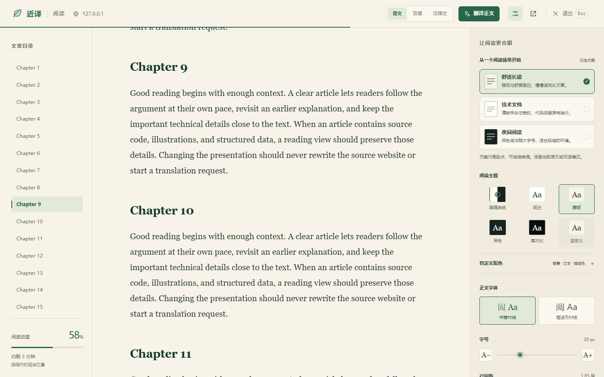
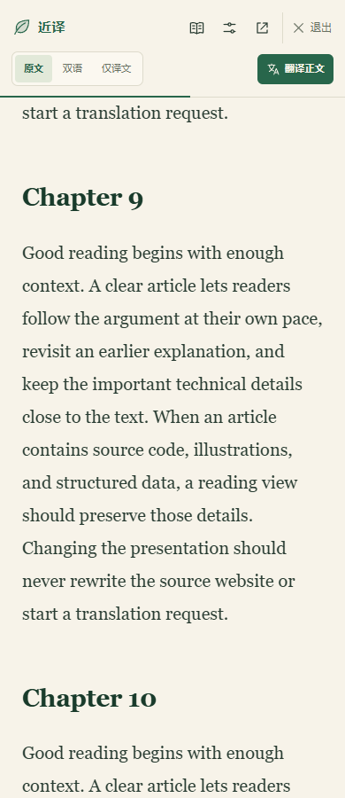

# 阅读翻译入口位置调整（0.10.1）

用户指出正文上方的操作条占用阅读空间，翻译按钮与模式切换分散，读到文章中间后还需要返回顶部寻找入口。

现在将「原文 / 双语 / 仅译文」和「翻译正文 / 停止 / 继续」放在固定阅读头部，靠近显示设置与退出。桌面保持一行；窄屏将翻译操作放在头部第二行。正文直接从文章标题开始，滚动文章时操作保持可见。

闲置说明不再占据正文。翻译进度、限流倒计时、失败原因及重试显示在工具栏下方；仅译文暂无内容的提示也放在同一区域。状态区改变高度时保持屏幕上的阅读位置；切换语言并清除旧译文时保留当前源段落位置。抽屉与遮罩跟随完整头部高度，打印时隐藏工具栏。

桌面滚动后的效果：

窄屏滚动后的效果：

本轮为 R1 展示层调整，沿用原有翻译回调、取消所有权、偏好保存及可访问名称。没有新增依赖或权限。

完整单元测试 1,217 项通过；TypeScript 和模块依赖边界检查通过。浏览器验证覆盖 1440 / 861 / 860 / 390 宽度、滚动后操作、200% 缩放、键盘访问、带状态区的抽屉定位、打印、切换语言时的阅读位置，以及跨页面限流倒计时。

最终 Chrome 24/24、Edge 18/18 项回归通过，使用隔离配置和模拟翻译服务。本机日常 Edge 原目录已备份并原位更新，333 个程序文件与构建哈希一致；重新加载后的实际运行版本为 0.10.1，26/26 项安装核验通过，包括头部控件、正文无操作条及滚动后可见。原配置与 Key 保留；核验仅使用自有样例页，未发送翻译、未保存偏好，专用标签与临时文件已清理。

证据：[验证摘要](../evidence/reading-toolbar-validation-2026-10-23.json)、[程序文件核对](../evidence/reading-toolbar-install-2026-10-23.json)、[实际安装核验](../evidence/reading-toolbar-installed-check-2026-10-23.json)。
